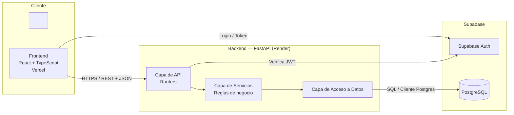

# Arquitectura del Proyecto — Sistema de Asistencia para Liquidación de Alquileres

**Trabajo Final Integrador — Tecnicatura Universitaria en Programación a Distancia** Alumnos: Olima, Nicolás — Pannunzio, Nicolás Tutor: Londero, Oscar

---

## 1\. Objetivo de este documento

Describir la arquitectura de software elegida para el proyecto, las tecnologías definitivas y la justificación de cada decisión técnica relevante, en el marco del alcance definido en la Primera Entrega (sistema complementario a Maru, para carga y validación de importes variables, cálculo de reparto entre propietarios y trazabilidad de las operaciones).

---

## 2\. Estilo arquitectónico elegido

**Arquitectura en capas (layered architecture), organizada como monolito modular**, con separación física entre frontend y backend (cliente-servidor vía API REST).

### Por qué NO microservicios

Se descartó explícitamente una arquitectura de microservicios. Justificación:

- El dominio del proyecto es acotado (propiedades, propietarios, conceptos variables, liquidaciones) y no presenta subdominios con ciclos de vida, equipos o necesidades de escalado independientes que justifiquen separarlos en servicios propios.  
- El equipo de desarrollo son 2 personas, con un plazo fijo de TFI. Microservicios agregan complejidad operativa (orquestación, comunicación entre servicios, despliegues independientes, observabilidad distribuida) que no resuelve ningún problema identificado en el relevamiento.  
- La carga de uso es baja (personal administrativo de una sola inmobiliaria, uso concentrado en el período mensual de liquidación), por lo que no hay un problema de escalabilidad real que una arquitectura distribuida vendría a resolver.  
- Meter microservicios acá sería tecnología por la tecnología, no una solución a un problema de negocio — va en contra del criterio que guía todo el proyecto.

### Por qué capas (y no, por ejemplo, arquitectura hexagonal completa)

Se eligió una arquitectura en capas simple, con separación de responsabilidades, en lugar de un esquema hexagonal/ports-and-adapters completo, porque:

- El sistema no tiene múltiples adaptadores de entrada/salida intercambiables (no hay, por ejemplo, distintos clientes de mensajería, distintas bases de datos, etc. entre los que haya que abstraerse). El único "adaptador externo" relevante es Supabase (Auth \+ Postgres).  
- Una arquitectura en capas bien separada ya cubre los objetivos de mantenibilidad y testeabilidad que se necesitan para este alcance, con menor complejidad conceptual y menor curva de aprendizaje para el equipo.  
- Es coherente con el nivel esperado de un TFI: se prioriza demostrar buenas prácticas de separación de responsabilidades por sobre la sofisticación arquitectónica.

---

## 3\. Vista general



El frontend nunca accede directamente a la base de datos ni escribe datos de negocio en Supabase por su cuenta: toda escritura y lectura de información de negocio (propiedades, propietarios, conceptos, liquidaciones) pasa por la API del backend, que es quien aplica las reglas de negocio, valida y registra auditoría. Supabase Auth se usa exclusivamente para autenticación (emisión de sesión/token); el backend es responsable de la autorización (qué puede hacer cada rol) — ver sección 6\.

---

## 4\. Componentes y organización interna

### 4.1 Frontend — React \+ TypeScript (Vercel)

Responsable de la interfaz para el personal administrativo. Organización propuesta:

```
frontend/
├─ src/
│  ├─ pages/            # Vistas: login, carga de conceptos, listado de propiedades,
│  │                     # liquidaciones, gestión de usuarios, etc.
│  ├─ components/        # Componentes de UI reutilizables
│  ├─ services/          # Cliente HTTP hacia la API del backend (fetch/axios envuelto)
│  ├─ hooks/             # Hooks propios (ej: useAuth, useLiquidaciones)
│  ├─ context/           # Estado de sesión/autenticación (token de Supabase Auth)
│  └─ types/             # Tipos TypeScript compartidos (DTOs que espejan los schemas del backend)
```

- El frontend consume **exclusivamente** la API REST del backend para todo lo que sea datos de negocio. La única interacción directa con Supabase es el flujo de login (Supabase Auth SDK), cuyo token luego se adjunta en cada request al backend.  
- Tipado fuerte de punta a punta (TypeScript en frontend, Pydantic en backend) para reducir errores de integración entre capas — esto ataca directamente uno de los problemas identificados en el relevamiento (inconsistencias por carga manual y falta de validación).

### 4.2 Backend — Python \+ FastAPI (Render)

Organizado en capas explícitas dentro de un único servicio:

```
backend/
├─ app/
│  ├─ routers/           # Capa de API: define los endpoints REST, recibe/devuelve schemas
│  ├─ schemas/            # Pydantic: DTOs de entrada/salida, validación de formato
│  ├─ services/           # Capa de negocio: reparto entre propietarios, validación de
│  │                       # duplicados/inconsistencias, cálculo de liquidación, generación
│  │                       # del snapshot, detección de estado "con advertencia"
│  ├─ repositories/       # Capa de acceso a datos: consultas/escrituras contra PostgreSQL
│  ├─ models/             # Modelos de datos (entidades persistentes)
│  ├─ core/               # Configuración, seguridad (verificación de JWT), dependencias
│  │                       # comunes (ej: usuario autenticado, control de rol)
│  └─ audit/              # Registro de auditoría (quién hizo qué, cuándo)
```

Responsabilidades por capa:

| Capa | Responsabilidad | No hace |
| :---- | :---- | :---- |
| Routers | Recibir requests HTTP, delegar a servicios, devolver respuestas | No contiene lógica de negocio |
| Schemas | Validar forma y tipos de los datos de entrada/salida | No accede a la base de datos |
| Services | Reglas de negocio (reparto fijo por propiedad, validación de 100%, snapshot, advertencias) | No arma queries SQL directamente |
| Repositories | Leer/escribir en PostgreSQL | No conoce reglas de negocio |
| Core | Verificar JWT de Supabase, resolver rol del usuario, autorizar operación | No decide reglas de negocio del dominio |

Esta separación es la que permite, por ejemplo, que la validación de que el reparto entre propietarios sume 100% (decisión ya tomada: se valida en el backend, no como constraint de base de datos) viva en la capa de servicios y sea testeable de forma aislada, sin depender de tener la base de datos levantada.

### 4.3 Autenticación y autorización

- **Autenticación**: delegada a Supabase Auth. El backend no gestiona contraseñas ni implementa mecanismos de login propios — se apoya en un proveedor ya probado, evitando reimplementar algo sensible que no es el objetivo del TFI.  
- **Autorización**: responsabilidad del backend. FastAPI valida el JWT emitido por Supabase en cada request (vía dependencia común) y resuelve el rol del usuario para decidir qué puede hacer (ej: quién puede dar de alta usuarios, quién puede cargar conceptos, quién solo puede consultar).  
- **Gestión de usuarios**: pantalla propia dentro de la aplicación (decisión ya tomada), en lugar de exponer el dashboard de Supabase al personal administrativo. Esto lo resuelve el backend con un router específico (`/usuarios`) que usa el rol de "administrador del sistema" para altas/bajas, y llama a la Admin API de Supabase Auth por detrás — el personal administrativo nunca ve ni toca Supabase directamente.

### 4.4 Base de datos — PostgreSQL vía Supabase

Entidades principales (nivel conceptual, sin llegar al DER completo en este documento): propiedades, propietarios, relación propiedad-propietario (N:M, con porcentaje fijo por propiedad), conceptos, concepto\_propiedad, liquidaciones (persistidas como snapshot, no calculadas al vuelo — decisión ya tomada), usuarios/roles, y registros de auditoría.

Se eligió Supabase como proveedor administrado de PostgreSQL (no una instancia propia en un VPS) para evitar tareas de administración de infraestructura (backups, parches, alta disponibilidad) que no aportan valor al objetivo del TFI y sí agregan riesgo operativo.

---

## 5\. Tecnologías definitivas y justificación

| Componente | Tecnología | Justificación |
| :---- | :---- | :---- |
| Frontend | React \+ TypeScript | Tipado estático reduce errores de integración con la API; ecosistema maduro; curva de aprendizaje conocida por el equipo |
| Backend | Python \+ FastAPI | Validación de datos integrada (Pydantic) ataca directamente el problema de "cargas duplicadas o inconsistentes" relevado; tipado y generación automática de documentación (OpenAPI) facilitan la integración frontend-backend |
| Comunicación | API REST \+ JSON | Estándar simple, suficiente para el volumen y complejidad del proyecto; no se justifica GraphQL ni gRPC para este alcance |
| Base de datos | PostgreSQL (Supabase) | Modelo relacional apropiado para las relaciones N:M (propietario-propiedad) y para persistir snapshots de liquidaciones con integridad referencial |
| Autenticación | Supabase Auth | Evita implementar autenticación desde cero; el equipo se enfoca en el problema de negocio, no en infraestructura de seguridad genérica |
| Hosting Frontend | Vercel | Despliegue simple para SPA de React, sin administrar servidores |
| Hosting Backend | Render | Despliegue simple de servicios Python/FastAPI, sin administrar VPS |
| Control de versiones | Git \+ GitHub | Repositorio único acordado desde la Primera Entrega |

Todas estas decisiones sostienen un mismo criterio: **evitar administrar infraestructura propia** (no hay VPS a mantener) y **concentrar el esfuerzo de desarrollo en el problema de negocio** (validaciones, reparto, trazabilidad), que es lo que realmente identificó el relevamiento.

---

## 6\. Seguridad y trazabilidad

- Toda operación de escritura relevante (carga de un concepto, generación de una liquidación, alta/baja de un usuario) queda registrada con quién la realizó y cuándo, para sostener la trazabilidad exigida por el alcance del proyecto.  
- Las liquidaciones se persisten como snapshot inmutable (decisión ya tomada) — esto es en sí mismo un mecanismo de auditoría: no se recalculan, así que siempre se puede reconstruir qué se comunicó al inquilino en un período determinado, aunque después cambien los conceptos cargados.  
- Los datos de propietarios e inquilinos (nombres, importes) se consideran información sensible del negocio: el acceso está limitado a personal administrativo autenticado, y no hay exposición pública de ningún endpoint de la API.  
- La autorización del sistema se resuelve exclusivamente en el backend (FastAPI): es la capa que valida el rol del usuario autenticado (\`admin\` / \`operador\`) y decide qué operaciones puede ejecutar sobre cada recurso, antes de llegar a la base de datos.

&nbsp;

  ---

## 7\. Requerimientos no funcionales

| Atributo | Definición para este proyecto |
| :---- | :---- |
| Escalabilidad | Baja exigencia: \~300 propiedades, uso concentrado en personal administrativo de una sola inmobiliaria. No requiere diseño para alta concurrencia |
| Disponibilidad | Aceptable con los niveles de servicio estándar de Vercel/Render/Supabase en sus planes gratuitos o de entrada; no se justifica arquitectura multi-región |
| Mantenibilidad | Sostenida por la separación en capas y el tipado fuerte de punta a punta |
| Auditabilidad | Registro de operaciones \+ snapshots inmutables de liquidaciones (ver sección 6\) |
| Seguridad | Autenticación delegada, autorización centralizada en el backend, sin exposición de Supabase al personal administrativo |

---

## 8\. Alternativas consideradas y descartadas

| Alternativa | Por qué se descartó |
| :---- | :---- |
| Microservicios | Complejidad operativa injustificada para el alcance y el equipo (ver sección 2\) |
| Integración técnica directa con Maru | Fuera de alcance desde la Primera Entrega: Maru ya resuelve liquidación formal, cobro y facturación; rehacerlo no aporta valor y la integración técnica no es viable en el marco de un TFI |
| Exponer el dashboard de Supabase al personal administrativo para gestión de usuarios | Riesgoso y poco viable operativamente dado la rotación de personal observada; se optó por una pantalla propia dentro de la app |
| VPS propio para hosting | Agrega carga de administración de infraestructura sin beneficio para el objetivo del proyecto; se optó por servicios administrados (Vercel/Render/Supabase) |

&nbsp;

---

## 9\. Relación con el alcance del proyecto

Esta arquitectura no agrega ninguna funcionalidad fuera del alcance definido en la Primera Entrega. Cada decisión responde a un problema concreto ya identificado en el relevamiento: carga manual sin validación (capa de servicios con reglas de validación explícitas), falta de trazabilidad (auditoría \+ snapshots), y riesgo de exponer herramientas técnicas al personal administrativo (pantalla propia de gestión de usuarios). No se incorpora IA, microservicios ni integraciones externas frágiles, en línea con lo ya descartado en la sección 5.2 de la Primera Entrega.