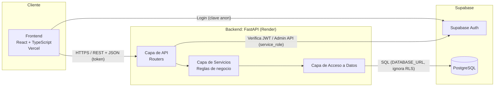

# Arquitectura del Proyecto: Sistema de Asistencia para Preliquidación de Alquileres

**Trabajo Final Integrador, Tecnicatura Universitaria en Programación a Distancia**
Alumnos: Olima, Nicolás — Pannunzio, Nicolás
Tutor: Londero, Oscar
Fecha de entrega final: 21 de noviembre

---

## 1. Objetivo de este documento

Describir la arquitectura de software, las tecnologías definitivas y la justificación de cada decisión técnica relevante, dentro del alcance definido en la Primera Entrega: un sistema complementario a Maru para cargar y validar importes variables, calcular el reparto entre propietarios y dejar trazabilidad de las operaciones.

El sistema produce una **preliquidación**: un resumen validado de conceptos variables por propiedad y período, con su reparto entre propietarios. No produce la liquidación oficial. Esa sigue generándola Maru.

Esta versión incorpora las correcciones del modelo posteriores a la segunda devolución del tutor. El detalle de cada cambio está en `CAMBIOS.md`.

---

## 2. Estilo arquitectónico elegido

**Arquitectura en capas, organizada como monolito modular**, con separación física entre frontend y backend (cliente-servidor vía API REST).

### Por qué no microservicios

- El dominio es acotado (propiedades, propietarios, conceptos variables, preliquidaciones) y no tiene subdominios con ciclos de vida, equipos o necesidades de escalado independientes.
- El equipo son 2 personas con un plazo fijo. Los microservicios agregan orquestación, comunicación entre servicios y despliegues independientes que no resuelven ningún problema del relevamiento.
- La carga es baja: personal administrativo de una sola inmobiliaria, concentrada en el período mensual de preliquidación.

### Por qué capas y no arquitectura hexagonal completa

- El sistema no tiene adaptadores de entrada o salida intercambiables. El único adaptador externo relevante es Supabase (Auth y PostgreSQL).
- Una arquitectura en capas bien separada cubre la mantenibilidad y la testeabilidad que necesita este alcance, con menor complejidad conceptual.
- Se prioriza la separación de responsabilidades por sobre la sofisticación arquitectónica.

---

## 3. Vista general



El despliegue previsto pone los tres componentes online: Supabase (base de datos y autenticación), Render (backend FastAPI) y Vercel (frontend React). Ver sección 7.

El frontend nunca accede a la base de datos ni escribe datos de negocio en Supabase. Toda lectura y escritura de información de negocio (propiedades, propietarios, conceptos, checklist, importes, preliquidaciones) pasa por la API del backend, que aplica las reglas de negocio, valida y registra auditoría. Supabase Auth se usa solo para autenticación (emisión de sesión y token). La autorización (qué puede hacer cada rol) la resuelve el backend; ver sección 6.

---

## 4. Componentes y organización interna

### 4.1 Frontend: React + TypeScript (Vercel)

Interfaz para el personal administrativo.

El código se organiza por módulo: cada módulo funcional tiene su carpeta en `features/`, con sus pantallas, formularios y componentes propios. Lo que usan todos los módulos vive en carpetas compartidas.

```
frontend/src/
├─ app/                 # Shell de la aplicación: rutas, guarda de rutas, layout y navegación
├─ components/          # Componentes de UI reutilizables
├─ services/            # Cliente HTTP hacia la API del backend (adjunta el token, maneja 401)
├─ context/             # Estado de sesión/autenticación (token de Supabase Auth)
├─ types/               # Tipos TypeScript (api.ts, generado desde docs/openapi.json)
└─ features/            # Un directorio por módulo, con el mismo nombre que en el backend
   ├─ usuarios/  propiedades/  conceptos/  plantilla/
   └─ checklist/  importes/  advertencias/  reparto/  preliquidaciones/
```

- Consume **solo** la API REST del backend para datos de negocio. La única interacción directa con Supabase es el login (SDK de Supabase Auth, con la clave `anon`). El token resultante se adjunta a cada request al backend.
- Tipado de punta a punta (TypeScript en el frontend, Pydantic en el backend) para reducir errores de integración entre capas.

### 4.2 Backend: Python + FastAPI (Render)

Un único servicio, organizado por módulo. Cada módulo es una carpeta de `app/modules/` y mantiene la separación en tres capas (presentación, servicio, persistencia) como archivos propios. El código de uso común está en `core/` y `audit/`.

```
backend/
├─ app/
│  ├─ main.py             # Creación de la app y registro de los routers de todos los módulos
│  ├─ core/               # Configuración, JWT, conexión a la base, formato de error y
│  │                      # dependencias comunes (usuario autenticado, require_admin)
│  ├─ audit/              # Registro de auditoría: audit.registrar(...) (quién hizo qué, cuándo)
│  └─ modules/            # Un directorio por módulo; cada uno tiene:
│     │                   #   router.py      capa de API
│     │                   #   schemas.py     DTOs de entrada/salida
│     │                   #   service.py     reglas de negocio
│     │                   #   repository.py  acceso a PostgreSQL
│     ├─ usuarios/  propiedades/  conceptos/  plantilla/
│     └─ checklist/  importes/  advertencias/  reparto/  preliquidaciones/
└─ tests/                 # conftest.py, una carpeta por módulo y cross/ (pruebas que cruzan módulos)
```

| Capa (archivo en cada módulo) | Responsabilidad | No hace |
|---|---|---|
| `router.py` | Recibir requests HTTP, delegar a `service.py`, devolver respuestas | No contiene lógica de negocio |
| `schemas.py` | Pydantic: validar forma y tipos de los datos de entrada/salida | No accede a la base de datos |
| `service.py` | Reglas de negocio del módulo: apertura de período y checklist, validación de duplicados, validación de 100 %, reparto y redondeo, advertencias, snapshot versionado | No arma queries SQL directamente |
| `repository.py` | Leer y escribir en PostgreSQL | No conoce reglas de negocio |
| `core/` | Verificar el JWT de Supabase, resolver el rol del usuario, autorizar la operación | No decide reglas del dominio |

Esta separación permite, por ejemplo, que la validación de que el reparto sume 100 % (se valida en el backend, no como constraint de base de datos) viva en `service.py` del módulo `propiedades` y se pruebe de forma aislada, sin base de datos levantada.

### 4.3 Autenticación y autorización

- **Autenticación**: delegada a Supabase Auth. El backend no gestiona contraseñas ni implementa login propio.
- **Vínculo con la tabla `usuario`**: `usuario.id` es el **mismo UUID** que `auth.users.id`. La columna no tiene `DEFAULT` y tiene `REFERENCES auth.users(id)`, de modo que no puede existir un usuario de la aplicación sin su cuenta de Auth. Alta de un usuario: el backend crea primero la cuenta en Supabase Auth con la Admin API y luego inserta la fila en `usuario` con el id devuelto. Si el insert falla, el backend elimina la cuenta de Auth recién creada para no dejar cuentas huérfanas. La baja es lógica (`usuario.activo = false`).
- **Primer administrador**: se crea a mano en Supabase Auth y se inserta su fila en `usuario` con rol `admin`. No puede sembrarse en el script SQL porque su id debe existir antes en `auth.users`.
- **Autorización**: responsabilidad del backend. FastAPI valida el JWT emitido por Supabase en cada request (dependencia común), busca al usuario en `usuario` y resuelve su rol (`admin` u `operador`) para decidir qué puede hacer.
- **Gestión de usuarios**: pantalla propia en la aplicación, con un router específico (`/usuarios`) que usa la Admin API de Supabase Auth por detrás. El personal administrativo no usa el dashboard de Supabase.

### 4.4 Base de datos: PostgreSQL vía Supabase

Entidades (el DER completo está en `diagrama_ER.md` y el DDL en `database/esquema_completo.sql`):

- Maestros: `propiedad`, `propietario`, `propiedad_propietario` (N:M con porcentaje), `concepto`, `concepto_propiedad` (plantilla por propiedad).
- Operación mensual: `checklist_periodo` (conceptos esperados en cada período) e `importe_mensual`.
- Resultado: `preliquidacion`, `preliquidacion_detalle`, `preliquidacion_advertencia` y `reparto`, persistidos como snapshot inmutable y versionado. La vista `preliquidacion_vigente` devuelve la versión vigente.
- Seguridad y trazabilidad: `usuario`, `rol` y `auditoria`.

Se eligió Supabase como PostgreSQL administrado, en lugar de una instancia propia en un VPS, para evitar tareas de infraestructura (backups, parches, alta disponibilidad) que no aportan al objetivo del TFI.

### 4.5 Reglas del modelo de datos y de negocio

**Período.** Se guarda siempre como el primer día del mes (`2026-09-01`). Un `CHECK` lo impone en `checklist_periodo`, `importe_mensual` y `preliquidacion`.

**Checklist por período.**

1. Abrir un período para una propiedad inserta una fila en `checklist_periodo` por cada `concepto_propiedad` activo, con estado `pendiente`.
2. Cargar un importe pasa la fila a `cargado`.
3. El usuario puede marcar una fila como `no_corresponde`.
4. Un importe $0 es un valor cargado (estado `cargado`). `pendiente` y `no_corresponde` son estados del checklist, no importes. Así un concepto faltante no se confunde con un importe 0.
5. Solo se cargan importes para conceptos que tienen fila en el checklist del período.
6. **Regla de generación**: generar una preliquidación se **bloquea** mientras exista alguna fila `pendiente`. El usuario puede continuar solo con una confirmación explícita, que queda registrada como una advertencia de tipo `pendiente_confirmado` (una por concepto pendiente) en `preliquidacion_advertencia`.

**Importes negativos.** `importe_mensual.importe`, `preliquidacion.importe_total` y `reparto.importe_correspondiente` admiten valores negativos (notas de crédito, bonificaciones), por eso no tienen `CHECK` de signo. Si el total de una preliquidación es negativo, se registra una advertencia de tipo `total_negativo`. Los porcentajes mantienen sus `CHECK` (mayor que 0 y hasta 100).

**Versionado de la preliquidación.**

- La clave `UNIQUE (propiedad_id, periodo, version)` permite varias versiones para el mismo período. La primera es la versión 1.
- La versión **vigente** es la de mayor `version` para esa propiedad y ese período (vista `preliquidacion_vigente`).
- Corregir un error genera una versión nueva (v2 reemplaza a v1). Ambas se conservan y v1 queda intacta.
- `preliquidacion_detalle` guarda, de forma inmutable, cada concepto con el importe aplicado. Contiene los conceptos en estado `cargado`, incluido el importe 0. Con la cabecera, el detalle y el reparto, una preliquidación responde qué conceptos se usaron, cuánto valía cada uno, qué total resultó y cómo se distribuyó, sin recurrir a la auditoría.
- `importe_total` es la suma de los importes del detalle.

**Inmutabilidad del snapshot.** Las filas de `preliquidacion`, `preliquidacion_detalle`, `preliquidacion_advertencia` y `reparto` nunca se actualizan ni se borran. Las claves foráneas hacia `preliquidacion` no usan `ON DELETE CASCADE`, y un trigger rechaza `UPDATE`, `DELETE` y `TRUNCATE` sobre esas cuatro tablas. El trigger protege de errores de la aplicación; no pretende impedir que un superusuario lo deshabilite a propósito.

**Reparto.**

- `propiedad_propietario` guarda el porcentaje vigente de cada propietario en la propiedad, con `UNIQUE (propiedad_id, propietario_id)`.
- Cada preliquidación tiene sus propias filas en `reparto` (clave foránea `preliquidacion_id`), con el `porcentaje_aplicado` copiado al momento de generarla y `UNIQUE (preliquidacion_id, propietario_id)`. Un propietario no se repite dentro de una preliquidación.
- **Cambio de porcentajes**: el backend lo ejecuta como **una sola transacción**. Reemplaza todas las filas de la propiedad y valida que la suma sea 100 antes del `COMMIT`. No hay estados intermedios inválidos: pasar de 50/50 a 60/40 nunca expone 60/50. Si la validación falla, la transacción se revierte.
- Las preliquidaciones ya generadas quedan protegidas por su propia copia de `reparto`: cambiar los porcentajes de la propiedad no las altera.
- **Redondeo**: el importe de cada propietario se calcula y se redondea a 2 decimales. El último propietario, en orden ascendente de id (orden determinista), absorbe la diferencia de centavos para que el reparto sume exactamente `importe_total`.
- Extensión futura, no implementada: vigencia temporal por fila en `propiedad_propietario`.

**Advertencia de variación inusual.**

- Se compara el importe cargado con el del **período inmediato anterior** del mismo `concepto_propiedad`.
- Variación porcentual: `|actual − anterior| / |anterior| × 100`. Se usan valores absolutos, de modo que un cambio de signo (por ejemplo una nota de crédito) también cuenta como variación.
- **Umbral efectivo** = `COALESCE(concepto.umbral_variacion_pct, umbral global)`. El umbral global por defecto es **30 %**. Es un valor inicial a confirmar con la inmobiliaria, porque debe surgir del relevamiento. Se configura en el backend, no en la base de datos.
- Si la variación supera el umbral, se registra una advertencia `variacion_inusual`.
- **Casos sin referencia**: si no hay período anterior para ese `concepto_propiedad`, si el concepto es nuevo o si el valor anterior es 0, no se emite advertencia de variación. Se deja solo una nota informativa de tipo `sin_referencia`.
- La advertencia es siempre **no bloqueante**.

**Tipos de advertencia** (`preliquidacion_advertencia.tipo`): `variacion_inusual`, `sin_referencia`, `total_negativo` y `pendiente_confirmado`.

---

## 5. Tecnologías definitivas y justificación

| Componente | Tecnología | Justificación |
|---|---|---|
| Frontend | React + TypeScript | Tipado estático reduce errores de integración con la API; ecosistema maduro; curva de aprendizaje conocida por el equipo |
| Backend | Python + FastAPI | La validación integrada (Pydantic) ataca las cargas duplicadas o inconsistentes relevadas; la documentación OpenAPI automática facilita la integración |
| Comunicación | API REST + JSON | Estándar simple, suficiente para el volumen y la complejidad del proyecto |
| Base de datos | PostgreSQL (Supabase) | Modelo relacional apropiado para la relación N:M propietario-propiedad y para persistir snapshots con integridad referencial |
| Autenticación | Supabase Auth | Evita implementar autenticación desde cero |
| Hosting frontend | Vercel | Despliegue simple de una SPA de React |
| Hosting backend | Render | Despliegue simple de un servicio FastAPI, sin administrar un VPS |
| Control de versiones | Git + GitHub | Repositorio único acordado desde la Primera Entrega |

El criterio común es evitar administrar infraestructura propia y concentrar el esfuerzo en el problema de negocio: validaciones, reparto y trazabilidad.

---

## 6. Seguridad y trazabilidad

### 6.1 Autorización y Row Level Security (estrategia única)

La estrategia es una sola, sin contradicciones entre el SQL y este documento:

- **RLS activada en todas las tablas y sin ninguna policy.** Para los roles `anon` y `authenticated`, esto equivale a denegar todo acceso a las tablas a través de la Data API de Supabase. Aunque alguien obtuviera la clave `anon` o un token de usuario, no podría leer ni escribir datos de negocio directamente.
- **La autorización vive en FastAPI.** El backend valida el JWT, resuelve el rol (`admin` u `operador`) y decide qué operaciones puede ejecutar cada usuario sobre cada recurso.
- **FastAPI accede a la base con un rol que ignora RLS**: la cadena de conexión directa `DATABASE_URL` para SQL y la clave `service_role` para la Admin API de Auth (crear y desactivar usuarios). Las policies no son necesarias porque nadie más que el backend llega a las tablas.
- La vista `preliquidacion_vigente` se crea con `security_invoker = true` para que respete las restricciones del rol que la consulta y no exponga datos por la Data API.

### 6.2 Manejo de secretos

- La clave `service_role` y `DATABASE_URL` existen **solo como variables de entorno en Render**. Nunca se incluyen en el frontend, en el repositorio ni en Vercel.
- El frontend usa únicamente la clave `anon` (pública por diseño) y solo para el login con Supabase Auth.
- El repositorio incluye un `.env.example` con nombres de variables y sin valores reales.

### 6.3 Trazabilidad

- Toda operación de escritura relevante (carga de un importe, generación de una preliquidación, alta o baja de un usuario) se registra en `auditoria` con quién la hizo y cuándo.
- Las preliquidaciones se persisten como snapshot inmutable y versionado (sección 4.5). No se recalculan: siempre se puede reconstruir qué conceptos, importes y reparto tenía cada versión, aunque después cambien los importes cargados o los porcentajes de la propiedad.
- Los datos de propietarios y los importes son información sensible del negocio. El acceso se limita a personal administrativo autenticado y no hay endpoints públicos de datos de negocio.

---

## 7. Despliegue

Los tres componentes se despliegan online. Este documento describe el despliegue objetivo; el estado real de cada componente se informa en el informe final.

| Componente | Plataforma | Variables de entorno |
|---|---|---|
| Base de datos y autenticación | Supabase | No aplica. El esquema se crea con `database/esquema_completo.sql` |
| Backend (FastAPI) | Render | `DATABASE_URL`, `SUPABASE_URL`, `SUPABASE_SERVICE_ROLE_KEY`, `CORS_ALLOWED_ORIGIN` (URL de Vercel), `UMBRAL_VARIACION_DEFAULT_PCT` (30.00) y, si el proyecto de Supabase lo requiere para verificar el JWT, `SUPABASE_JWT_SECRET` |
| Frontend (React) | Vercel | `VITE_API_URL` (URL del backend en Render), `VITE_SUPABASE_URL` y `VITE_SUPABASE_ANON_KEY` |

Notas:

- **CORS**: el backend solo acepta el origen de la URL de Vercel.
- **Cold start**: el plan gratuito de Render suspende el servicio tras un período de inactividad. La primera request puede tardar decenas de segundos. Hay que tenerlo en cuenta al preparar la demo (abrir la URL del backend unos minutos antes) y mostrar un estado de carga en el frontend.
- **Conexión a la base**: si la conexión directa a Supabase no es accesible desde Render, se usa la cadena de conexión del pooler que ofrece Supabase. Se verifica al desplegar.
- Ninguna variable con secretos se define en Vercel.

---

## 8. Requerimientos no funcionales

| Atributo | Definición para este proyecto |
|---|---|
| Escalabilidad | Baja exigencia: unas 300 propiedades y uso concentrado en personal administrativo de una sola inmobiliaria. No requiere diseño para alta concurrencia |
| Disponibilidad | Aceptable con los niveles de servicio de los planes gratuitos o de entrada de Vercel, Render y Supabase (con el cold start de Render descrito arriba). No se justifica una arquitectura multi-región |
| Mantenibilidad | Separación en capas y tipado de punta a punta |
| Auditabilidad | Registro de operaciones y snapshots inmutables y versionados de preliquidaciones (ver sección 6.3) |
| Seguridad | Autenticación delegada, autorización centralizada en el backend, RLS en modo deny-all y secretos solo en el backend |

---

## 9. Alternativas consideradas y descartadas

| Alternativa | Por qué se descartó |
|---|---|
| Microservicios | Complejidad operativa injustificada para el alcance y el equipo (ver sección 2) |
| Integración técnica directa con Maru | Fuera de alcance desde la Primera Entrega: Maru ya resuelve la liquidación oficial, el cobro y la facturación, y la integración técnica no es viable en un TFI |
| Dashboard de Supabase para gestionar usuarios | Riesgoso y poco viable por la rotación de personal; se optó por una pantalla propia |
| Policies de RLS por rol en la base de datos | Duplicarían en SQL la autorización que ya resuelve FastAPI. Se eligió RLS deny-all con acceso solo desde el backend |
| VPS propio para hosting | Agrega administración de infraestructura sin beneficio para el objetivo; se usan servicios administrados |

---

## 10. Fuera de alcance / trabajo futuro

Los siguientes elementos estaban en la entrega anterior y se **excluyen** del alcance de la entrega final:

- Gestión de contratos e inquilinos (tablas `inquilino`, `contrato` y `contrato_inquilino`, y su módulo).
- Alertas de vencimiento de contratos (tabla `alerta_vencimiento` y su módulo).
- Envío de emails y elección de un proveedor de email.

Motivos: el tutor recomendó no empezar por emails ni por alertas de contratos, porque amplían el alcance sin ser parte del flujo núcleo; las indicaciones de las últimas rondas piden no agregar funcionalidades y entregar una versión estable, probada y defendible.

Si se retoman como trabajo futuro, habría que resolver antes: contrato vigente más contrato futuro programado, un proceso diario robusto ante fallas (que se pueda ejecutar al día siguiente) y la elección de un proveedor de email.

También quedan como extensiones futuras la vigencia temporal de los porcentajes de reparto y la integración con WhatsApp (generar el texto y abrir el chat, con confirmación humana).

---

## 11. Relación con el alcance del proyecto

Esta arquitectura no agrega funcionalidad fuera del alcance de la Primera Entrega. Cada decisión responde a un problema del relevamiento: carga manual sin validación (reglas explícitas en la capa de servicios), falta de trazabilidad (auditoría y snapshots versionados) y riesgo de exponer herramientas técnicas al personal administrativo (pantalla propia de gestión de usuarios). No se incorporan IA, microservicios ni integraciones externas frágiles.
