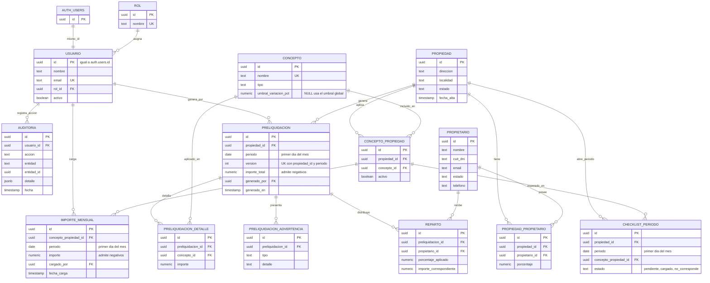

# Diagrama entidad-relación (modelo corregido)

Entidades persistidas en PostgreSQL (Supabase). `AUTH_USERS` pertenece a Supabase Auth (esquema `auth`) y se muestra solo para indicar que `USUARIO.id` es el mismo UUID. Las reglas que el diagrama no expresa están en [`arquitectura.md`](arquitectura.md) (sección 4.5) y en [`../database/esquema_completo.sql`](../database/esquema_completo.sql).

## Restricciones que el diagrama no muestra

| Tabla | Restricción |
|---|---|
| `propiedad_propietario` | `UNIQUE (propiedad_id, propietario_id)` |
| `concepto_propiedad` | `UNIQUE (propiedad_id, concepto_id)` |
| `checklist_periodo` | `UNIQUE (propiedad_id, periodo, concepto_propiedad_id)`; FK compuesta `(concepto_propiedad_id, propiedad_id)` hacia `concepto_propiedad` |
| `importe_mensual` | `UNIQUE (concepto_propiedad_id, periodo)` |
| `preliquidacion` | `UNIQUE (propiedad_id, periodo, version)`, `version >= 1` |
| `preliquidacion_detalle` | `UNIQUE (preliquidacion_id, concepto_id)` |
| `reparto` | `UNIQUE (preliquidacion_id, propietario_id)` |
| `checklist_periodo`, `importe_mensual`, `preliquidacion` | `periodo` es el primer día del mes (`CHECK`) |
| `preliquidacion`, `preliquidacion_detalle`, `preliquidacion_advertencia`, `reparto` | Snapshot inmutable: trigger que rechaza `UPDATE`, `DELETE` y `TRUNCATE`; sin `ON DELETE CASCADE` |
| `concepto` | `UNIQUE INDEX uq_concepto_nombre_ci ON concepto (lower(nombre))` |

La vista `preliquidacion_vigente` devuelve, por `(propiedad_id, periodo)`, la fila de `preliquidacion` con mayor `version`.
