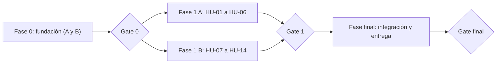

# Plan de implementación: división del trabajo entre Integrante A e Integrante B

Este plan define quién hace qué, en qué orden de dependencias y cuándo una unidad está terminada. No contiene plazos: el desarrollo es asistido por agentes de código y el avance se mide por compuertas (gates), no por calendario. El backlog funcional está en [`requerimientos.md`](requerimientos.md), la arquitectura en [`arquitectura.md`](arquitectura.md), los módulos en [`listado_modulos.md`](listado_modulos.md) y el DDL en [`../database/esquema_completo.sql`](../database/esquema_completo.sql). Las exigencias del tutor para la entrega están en [`wiki/01`](../../wiki/01_devoluciones_feedback.md) y [`wiki/02`](../../wiki/02_checklist_y_pendientes.md).



## 1. Objetivo y principios

Objetivo: dejar desplegado y probado el recorrido que exige el tutor (login, propiedad real anonimizada, propietarios y reparto, apertura de período, checklist, carga, duplicado rechazado, faltantes y advertencias, preliquidación versionada, consulta histórica y caso de corrección v1 a v2), sin funcionalidad nueva.

- **Contrato primero.** Las rutas y los formatos se acuerdan y se mergean antes de dividir el trabajo (Gate 0). Cambiarlos requiere la aprobación del otro integrante.
- **Cortes verticales.** Cada integrante entrega backend, frontend y pruebas de sus HU. Nadie construye "toda la capa de servicios".
- **Propiedad disjunta.** Cada módulo tiene un solo dueño y vive en directorios propios. Lo compartido se cambia solo con PRs chicos y coordinados (sección 2).
- **Pruebas desde los criterios de aceptación.** Cada criterio de `requerimientos.md` sección 7 se convierte en un caso de prueba antes de implementar la unidad.
- **Sin funcionalidad nueva.** Lo que no está en el alcance de `requerimientos.md` sección 2 no se construye. Los defectos se corrigen; las ideas se anotan como trabajo futuro.
- **Honestidad implementado vs proyectado.** El informe y el README declaran solo lo que corre en el sistema desplegado. Lo demás figura como proyectado.

## 2. Estructura del repositorio y propiedad de archivos

```
/
├─ README.md                      # F0-01 el esqueleto, Fase final el contenido
├─ .env.example                   # solo nombres de variables, sin valores
├─ .github/workflows/ci.yml       # F0-11
├─ backend/
│  ├─ app/
│  │  ├─ main.py                  # creación de la app y registro de routers (fundación)
│  │  ├─ core/                    # config, JWT, DB, formato de error, require_admin (fundación)
│  │  ├─ audit/                   # audit.registrar(...) (fundación)
│  │  └─ modules/                 # cada módulo: router.py, schemas.py, service.py, repository.py y, si posee tablas, models.py
│  │     ├─ usuarios/  propiedades/  conceptos/  plantilla/                          # A
│  │     └─ checklist/  importes/  advertencias/  reparto/  preliquidaciones/        # B
│  └─ tests/                      # conftest.py (fundación), <módulo>/ (dueño), cross/ (ambos)
├─ frontend/src/
│  ├─ app/  components/  services/  context/  types/    # shell, UI común, cliente API, sesión, tipos (fundación)
│  │                              #   app/ incluye los archivos de ruta, routeTree.gen.ts, la guarda y el QueryClient
│  └─ features/                   # un directorio por módulo, mismo dueño que el backend: pantallas, queries
├─ database/                      # esquema_completo.sql, seed/, migrations/ (solo si hay un defecto)
└─ docs/                          # modelo, plan, openapi.json, pruebas, evidencia, informe
```

El árbol sale de `modelo_corregido\`: `docs\` pasa a `docs/` y `database\` pasa a `database/`.

**Relación con `arquitectura.md` 4.1 y 4.2.** Ambas secciones describen esta misma estructura: carpetas por módulo para que los directorios de A y B no se superpongan, y las capas como archivos dentro de cada módulo. Las convenciones de SQLModel y TanStack se resumen allá y se detallan en las dos subsecciones siguientes.

**Módulos funcionales y carpetas.** Los 11 módulos de [`listado_modulos.md`](listado_modulos.md) corresponden a carpetas del código así:

| Módulo funcional | Carpeta |
|---|---|
| 1 Autenticación | `core/` (backend) y `context/` (frontend) |
| 2 ABM de propiedades y propietarios | `modules/propiedades/` |
| 3 Catálogo de conceptos | `modules/conceptos/` |
| 4 Plantilla por propiedad | `modules/plantilla/` |
| 5 Apertura de período y checklist | `modules/checklist/` |
| 6 Carga de importes | `modules/importes/` |
| 7 Reparto | `modules/reparto/` |
| 8 Preliquidación | `modules/preliquidaciones/` |
| 9 Auditoría | `audit/` |
| 10 Usuarios y roles | `modules/usuarios/` |
| 11 Advertencias | `modules/advertencias/` |

| Ruta | Dueño | Regla de cambio |
|---|---|---|
| `modules/{usuarios,propiedades,conceptos,plantilla}` (incluido su `models.py`) y `features/` homónimos, y sus tests | A | Solo A. El otro revisa el PR. |
| `modules/{checklist,importes,advertencias,reparto,preliquidaciones}` (incluido su `models.py`) y `features/` homónimos, y sus tests | B | Solo B. El otro revisa el PR. |
| `core/`, `audit/`, `main.py`, `components/`, `services/`, `context/`, `types/api.ts`, nav y layout, archivos de ruta y `routeTree.gen.ts` (en `app/`), `conftest.py`, `.github/`, `.env.example` | Fundación (compartido) | PR propio `chore(shared): ...`, chico, aprobado por el otro. Nunca mezclado con una unidad de módulo. |
| `docs/openapi.json` | Compartido | Se regenera desde el código. Un cambio de contrato lo aprueba el otro. |
| `database/esquema_completo.sql` | Compartido | Congelado. Un defecto se corrige con una migración numerada en `database/migrations/`, aprobada por ambos y reflejada en la documentación del modelo. |
| `database/seed/` | A (F0-03) | Congelado en Gate 0. Cambios por acuerdo. |
| `tests/cross/` | Ambos | Pruebas que cruzan los dos cortes (Gate 1). |

Los routers de todos los módulos se registran en Fase 0 con rutas stub (respuesta 501). Después, nadie toca `main.py` para agregar un módulo.

### Persistencia con SQLModel

El acceso a datos usa SQLModel (sobre SQLAlchemy) con `Session` síncrona. Las convenciones siguientes evitan que A y B definan la misma tabla dos veces o dependan del código del otro.

**Propiedad de las tablas.** Cada tabla la posee un solo módulo, y solo ese módulo la declara con `table=True` en su `models.py`. La asignación es una propuesta derivada de este plan, y el equipo la confirma.

| Carpeta | Dueño | Tablas que posee en `models.py` |
|---|---|---|
| `modules/usuarios` | A | `usuario`, `rol` |
| `modules/propiedades` | A | `propiedad`, `propietario`, `propiedad_propietario` |
| `modules/conceptos` | A | `concepto` |
| `modules/plantilla` | A | `concepto_propiedad` |
| `modules/checklist` | B | `checklist_periodo` |
| `modules/importes` | B | `importe_mensual` |
| `modules/preliquidaciones` | B | `preliquidacion`, `preliquidacion_detalle`, `preliquidacion_advertencia`, `reparto` |
| `audit/` | Fundación | `auditoria` |

`modules/advertencias` y `modules/reparto` no mapean tablas propias. `reparto` contiene solo `repartir`, una función pura que no consulta la base. `advertencias` calcula la variación con una función pura, pero su `GET /advertencias` lee `importe_mensual`, `checklist_periodo`, `concepto` y `concepto_propiedad`, tablas de otros módulos, desde su `repository.py` (convención 2). Por eso tiene `router.py` y `repository.py`, pero ningún `models.py` con tablas. La tabla `reparto` y la tabla `preliquidacion_advertencia` pertenecen a `preliquidaciones`, que es quien las escribe al generar la preliquidación. Los módulos escriben en `auditoria` solo con `audit.registrar(...)`.

**Convenciones.**

1. **Un modelo por tabla y por módulo.** `models.py` declara solo las clases `table=True` de las tablas que el módulo posee.
2. **Tablas de otro módulo.** Si un módulo necesita leer una tabla ajena, la consulta en su `repository.py` con construcciones livianas `table()` y `column()` de SQLAlchemy y un join explícito. No importa código del otro módulo ni declara `Relationship` entre módulos. Redefinir una clase mapeada sobre la misma tabla falla con el error "Table already defined", mientras que un join con `table()` de Core funciona.
3. **Claves foráneas entre módulos.** Una columna que apunta a una tabla de otro módulo se declara sin `foreign_key=` en el modelo. La base sigue haciendo cumplir la clave foránea por el DDL, que es la fuente de verdad. Con `foreign_key="propiedad.id"`, SQLAlchemy lanza `NoReferencedTableError` al insertar o consultar si la tabla referenciada no está registrada en el `metadata`. Las claves foráneas entre tablas del mismo módulo pueden usar `foreign_key=`. Por ejemplo, `checklist_periodo.concepto_propiedad_id` se declara sin `foreign_key=` porque `concepto_propiedad` pertenece a `plantilla`.
4. **El esquema sale del SQL.** El esquema viene de `database/esquema_completo.sql`. No se usa `SQLModel.metadata.create_all()`: crearía una segunda versión del esquema, sin los triggers ni los `CHECK` del DDL. Los tests construyen la base descartable desde el archivo SQL.
5. **Routers y schemas.** Los routers devuelven clases de `schemas.py`, nunca modelos `table=True`.
6. **Dinero y porcentajes.** Son `Decimal` (columnas `Numeric`), como ya exige el contrato. Los modelos no usan `float`.
7. **Choques de unicidad.** Un duplicado de importe o un choque de `UNIQUE (propiedad_id, periodo, version)` sale de la sesión como `IntegrityError`. La capa que ejecuta la operación lo traduce al 409 del contrato de la sección 4.
8. **Conexión.** Un engine síncrono se construye desde `DATABASE_URL` en `core/`. F0-04 elige y documenta el driver (se propone psycopg 3). Si se usa el pooler de Supabase en modo transacción, hay que desactivar los prepared statements (en psycopg 3, `prepare_threshold=None`).

### Frontend con TanStack

El frontend usa cuatro librerías de TanStack. Las reglas de uso son estas.

- **TanStack Query.** Todas las llamadas a la API pasan por Query, que también maneja el caché y la invalidación después de cada escritura. Un único `QueryClient` vive en el shell compartido, y el manejo del 401 (redirección al login) se hace una sola vez en su handler global de errores de queries y mutaciones. Los hooks de consulta y las query keys viven en `features/<módulo>/`, sin una carpeta global `hooks/`. Los componentes no guardan copias de datos del servidor.
- **TanStack Router.** Define el árbol de rutas y la guarda de sesión y rol con `beforeLoad`. Los archivos de ruta son delgados: cada uno importa la pantalla desde `features/<módulo>/`. F0-07 crea todos los archivos de ruta como stubs, uno por módulo, para que nadie edite el árbol de rutas después. El archivo generado `routeTree.gen.ts` se versiona, no se edita a mano y pertenece a la fundación: solo cambia en un PR `chore(shared)`.
- **TanStack Table.** Orden, filtro y paginación de las listas (propiedades, conceptos, checklist y versiones de preliquidación).
- **TanStack Form.** Validación del lado del cliente antes de enviar. La validación del backend siempre decide. Los importes y porcentajes se mantienen como cadenas decimales en los formularios y nunca se convierten a `float`.
- **Errores.** El formato `{codigo, mensaje, detalle}` se interpreta una sola vez en `services/`, y el texto de la interfaz se elige según `codigo`.

## 3. Fase 0: fundación

Orden: F0-01, luego F0-02, F0-03, F0-04 y F0-07 en paralelo, luego F0-05 y F0-06, luego F0-08, luego F0-09, F0-10 y F0-11, y por último F0-12.

| Unidad | Dueño | Salida | Done cuando |
|---|---|---|---|
| F0-01 Esqueleto del monorepo | A | Árbol de la sección 2 (cada carpeta de módulo con `router.py`, `schemas.py`, `service.py` y `repository.py`; el `models.py` lo crea la unidad que declara las tablas del módulo, no el esqueleto), `.gitignore` que excluye `.env`, `.env.example` por componente, README mínimo, `docs/` y `database/` copiados desde `modelo_corregido\`. | El árbol existe en `main` y no hay ningún archivo `.env` versionado. |
| F0-02 Supabase y esquema | A | Proyecto Supabase con `esquema_completo.sql` aplicado. Cuentas en Auth para un `admin` y un `operador` de prueba, con su fila en `usuario` (mismo UUID). | La consulta a `pg_tables` muestra las 14 tablas con RLS activa. Los dos usuarios existen en `auth.users` y en `usuario`. Una consulta a la Data API con la clave `anon` sobre `propiedad` no devuelve filas. |
| F0-03 Datos semilla y reinicio | A | `database/seed/seed_demo.sql` y `reset_demo.sql`. Una propiedad real anonimizada con copropietarios (suman 100), catálogo de conceptos con uno de umbral propio, plantilla con al menos un concepto inactivo, importes del período anterior de algunos conceptos (para HU-10 con y sin referencia). | El seed corre sobre una base limpia sin errores. El otro integrante confirma que no quedan nombres, CUIT, DNI ni direcciones reales. El script de reinicio deshabilita los triggers de inmutabilidad, por eso queda marcado como solo para ensayo, nunca para tests ni producción de la demo final. |
| F0-04 Esqueleto del backend | B | FastAPI con configuración por variables de entorno, engine y dependencia `Session` de SQLModel construidos desde `DATABASE_URL` (con el pooler de Supabase como alternativa), con el driver elegido y documentado (se propone psycopg 3) y los prepared statements desactivados si se usa el pooler en modo transacción, formato de error único, routers stub registrados y `GET /health` con chequeo de base. | `GET /health` responde 200 con estado de base `ok` en local. |
| F0-05 Autenticación, rol y auditoría | B | Dependencia que verifica el JWT de Supabase, carga `usuario` y rechaza al inactivo con 403 y código `usuario_inactivo`. `require_admin`. `GET /me`. `audit.registrar(usuario_id, accion, entidad, entidad_id, detalle)`. `GET /propiedades` de solo lectura (humo de punta a punta). | Tests: sin token 401, token inválido 401, usuario inactivo 403 con `usuario_inactivo`, `operador` rechazado por `require_admin`, `audit.registrar` inserta una fila en `auditoria`. |
| F0-06 Entorno de pruebas | B | `pytest` con fixtures, y una base descartable con `auth.users` simulado (así se ejecutó el DDL, ver [`wiki/00`](../../wiki/00_overview.md)). Los fixtures entregan una `Session` sobre esa base, con el esquema cargado desde `esquema_completo.sql` y sin `create_all()`. Decisión del equipo: los tests automáticos y la CI corren contra un PostgreSQL local descartable (el servicio local o un contenedor), y existe un único proyecto Supabase para integración y demo. `reset_demo.sql` no se ejecuta contra ese proyecto una vez que empieza el ensayo de la demo. | `pytest` termina en verde, incluida una prueba de que el trigger rechaza un `UPDATE` sobre `preliquidacion`. |
| F0-07 Esqueleto del frontend | A | React + TypeScript con login por Supabase Auth (clave `anon`), contexto de sesión, cliente API que adjunta el token y maneja 401, TanStack Router con guarda en `beforeLoad` y todos los archivos de ruta creados como stubs (uno por módulo), `QueryClient` con manejo central del 401, layout y navegación con una entrada vacía por módulo, estado de carga visible, lista de propiedades como prueba de humo, armada con TanStack Table. | Con las cuentas de F0-02, el login real lleva a la lista de propiedades de la semilla leída desde el backend local. |
| F0-08 Contrato de API | Ambos | Stubs con schemas Pydantic para todas las rutas de la sección 4, `docs/openapi.json` generado, `frontend/src/types/api.ts` generado desde él, y el formato de error de la sección 4 implementado en `core/`. | `docs/openapi.json` y `types/api.ts` están mergeados. Los dos integrantes aprobaron el PR. Un test confirma que un 422 de validación devuelve `{codigo, mensaje, detalle}`. |
| F0-09 Despliegue del backend | B | Servicio en Render con `DATABASE_URL`, `SUPABASE_URL`, `SUPABASE_SERVICE_ROLE_KEY`, `CORS_ALLOWED_ORIGIN`, `UMBRAL_VARIACION_DEFAULT_PCT` y, si el proyecto lo requiere, `SUPABASE_JWT_SECRET` ([`arquitectura.md`](arquitectura.md) sección 7). | `GET /health` responde 200 con base `ok` desde la URL pública de Render. |
| F0-10 Despliegue del frontend | A | Proyecto en Vercel con `VITE_API_URL`, `VITE_SUPABASE_URL` y `VITE_SUPABASE_ANON_KEY`. `CORS_ALLOWED_ORIGIN` de Render apunta a la URL de Vercel. | El login desde la URL de Vercel lista las propiedades de la semilla, sin errores de CORS en la consola. Buscar `service_role` y `DATABASE_URL` en el bundle y en el repositorio no da resultados. |
| F0-11 CI (si es barato) | B | Workflow con `pytest`, build y chequeo de tipos del frontend, y regeneración de `docs/openapi.json` que falla si hay diferencias. `routeTree.gen.ts` debe estar actualizado: se genera y se compara igual que `openapi.json`, antes del chequeo de tipos del frontend. | Corre en verde sobre `main` y falla cuando `openapi.json` está desactualizado. |
| F0-12 Verificación cruzada | Ambos | Cada uno verifica el componente desplegado por el otro. | Se cumple el Gate 0. |

**Gate 0.** Se divide el trabajo solo cuando todo esto es verdadero:

1. `GET /health` responde desde la URL pública de Render, con base `ok`.
2. El login funciona desde la URL de Vercel contra Supabase y la pantalla muestra datos leídos por el backend con el token.
3. Una request sin token a cualquier ruta distinta de `/health` devuelve 401.
4. `docs/openapi.json` y `types/api.ts` están mergeados y la sección 4 no tiene puntos abiertos.
5. La semilla está cargada y verificada por el otro integrante.
6. `pytest` y el build del frontend corren en verde en local y, si existe F0-11, en CI.
7. Las variables de entorno están cargadas en Render y Vercel según la arquitectura, y la verificación de secretos (F0-10) está limpia.

## 4. Contrato de API

Las fuentes fijan solo el prefijo `/usuarios` ([`arquitectura.md`](arquitectura.md) 4.3). Las demás rutas son una propuesta derivada de las HU y se implementan como stubs en F0-08. Las decisiones de contrato están cerradas; F0-08 las implementa y puede ajustar nombres de campos, nunca códigos ni formato de error sin acuerdo de ambos.

Reglas comunes:

- Todas las rutas, salvo `GET /health`, exigen `Authorization: Bearer <jwt>`. Sin token o con token inválido responde 401. Usuario inactivo: 403 con código de error `usuario_inactivo` (decisión del equipo).
- Los importes y porcentajes viajan como cadenas decimales (`"15000.00"`), nunca como números de coma flotante. En el backend se usa `Decimal`.
- `periodo` viaja como `AAAA-MM-01`.
- Códigos de error: 401 autenticación, 403 permiso, 404 no existe, 409 conflicto (duplicado, ya existe, pendientes sin confirmar, estado previo faltante), 422 validación del cuerpo, 502 falla de una dependencia externa (Supabase Auth). El cuerpo de error es siempre `{"codigo": "...", "mensaje": "...", "detalle": {...}}`, también para los 422 de validación, que un handler en `core/` convierte a este formato (decisión del equipo). El frontend decide el texto según `codigo`.
- Las fuentes no definen permisos por rol salvo que solo `admin` gestiona usuarios ([`requerimientos.md`](requerimientos.md) sección 9). Todo lo demás lo puede operar cualquier usuario activo.

| HU | Método y ruta | Dueño | Request → respuesta | Errores |
|---|---|---|---|---|
| HU-01 | `GET /health` (público), `GET /me` | Fundación, luego A | → `{id, nombre, email, rol, activo}` | 401, 403 |
| HU-02 | `GET /usuarios` | A | → lista de usuarios | 403 no admin |
| HU-02 | `POST /usuarios` | A | `{email, nombre, rol}` más contraseña inicial, que define el admin en el alta (decisión del equipo) → 201 con el usuario | 403, 409 email repetido, 502 `auth_error` si falla la Admin API de Auth (no se crea nada), 500 `error_interno` si falla el insert en `usuario`, tras borrar el usuario de Auth para compensar. Si la compensación también falla, se loguea el id huérfano y se documenta como limitación (decisión del equipo) |
| HU-02 | `PATCH /usuarios/{id}`, `POST /usuarios/{id}/baja` | A | `{nombre?, rol?}`; la baja → `activo=false` | 403, 404 |
| HU-03 | `GET/POST /propiedades`, `GET/PATCH /propiedades/{id}` | A | `{direccion, localidad?, estado?}` → propiedad (`estado` inicial `activa`) | 404, 422 |
| HU-03 | `GET/POST /propietarios`, `GET/PATCH /propietarios/{id}` | A | `{nombre, cuit_dni?, email?, telefono?}` → propietario | 404, 422 |
| HU-03, HU-04 | `GET/PUT /propiedades/{id}/propietarios` | A | PUT reemplaza todo en una transacción: `[{propietario_id, porcentaje}]` → reparto vigente | 404, 422 propietario repetido, porcentaje fuera de rango, suma distinta de 100 |
| HU-05 | `GET/POST /conceptos`, `PATCH /conceptos/{id}` | A | `{nombre, tipo?, umbral_variacion_pct?}` → concepto | 409 nombre repetido, 422 umbral menor o igual a 0 |
| HU-06 | `GET/POST /propiedades/{id}/conceptos`, `PATCH /propiedades/{id}/conceptos/{concepto_propiedad_id}` | A | `{concepto_id}`; `{activo}` → concepto de la propiedad | 404, 409 ya asociado |
| HU-07 | `POST /checklist` | B | `{propiedad_id, periodo}` → 201 checklist nuevo o 200 el existente, con `[{id, concepto_propiedad_id, concepto, estado, importe_id?, importe?}]` | 404, 422 período que no es `AAAA-MM-01` (se rechaza, no se normaliza; decisión del equipo) |
| HU-07, HU-09 | `GET /checklist?propiedad_id&periodo` | B | → mismo checklist | 404 |
| HU-08 | `POST /importes` | B | `{propiedad_id, periodo, concepto_propiedad_id, importe}` → 201 con la fila en `cargado` | 409 duplicado (conserva el primero), 422 concepto sin fila en el checklist |
| HU-09 | `POST /checklist/{id}/no-corresponde` | B | Funciona sobre filas `pendiente` y `cargado` (RN-25). → 200 con la fila en `no_corresponde` sin importe y `estado_anterior`; si estaba `cargado`, incluye `importe_eliminado`. Una transacción: borra el `importe_mensual`, audita el valor anterior y cambia el estado. Si la fila ya está `no_corresponde`, responde 200 idempotente (`estado_anterior = no_corresponde`), sin cambios ni auditoría. No depende de que exista una preliquidación | 404 |
| HU-10 | `GET /advertencias?propiedad_id&periodo` | B | → `[{concepto_propiedad_id, tipo, detalle}]`, vista previa que no persiste | 404 |
| HU-11, HU-14 | `POST /preliquidaciones` | B | `{propiedad_id, periodo, confirmar_pendientes=false}` → 201 con cabecera, detalle, advertencias y reparto; versión = máxima + 1 | 409 `pendientes_sin_confirmar` con la lista de pendientes si no se confirmó, 409 `periodo_sin_checklist`, 409 `propiedad_sin_reparto`, 409 `reparto_invalido` si los porcentajes no suman 100, 404 propiedad inexistente (decisión del equipo) |
| HU-12 | `GET /preliquidaciones?propiedad_id&periodo`, `GET /preliquidaciones/vigente?propiedad_id&periodo`, `GET /preliquidaciones/{id}` | B | → versiones, la vigente, o el detalle completo de una versión | 404 |
| HU-13 | `PATCH /importes/{id}` | B | `{importe}` → importe corregido; la auditoría guarda el valor anterior | 404, 422 |

`GET /preliquidaciones/vigente` se declara antes que `/{id}` para que el router no interprete `vigente` como un id.

## 5. Fase 1: trabajo en paralelo

### Integrante A: configuración y administración

Asignación de HU a módulo tomada de la trazabilidad de [`requerimientos.md`](requerimientos.md) sección 8. HU-03 cubre propiedades y propietarios; HU-04, los porcentajes de reparto.

| Unidad | HU / RN | Alcance: backend, frontend, tests | Done cuando | Depende de |
|---|---|---|---|---|
| A1 Endurecimiento del login | HU-01 / RN-03, RN-04 | Back: cobertura de 401 y de rechazo al inactivo en todas las rutas. Front: guarda de rutas, redirección al login ante 401, cierre de sesión. Tests: los 4 criterios, más un test que recorre `openapi.json`. | Los 4 criterios de HU-01 pasan como tests. El test sobre `openapi.json` falla si una ruta distinta de `/health` acepta una request sin token. La consulta con clave `anon` queda registrada como evidencia. | Gate 0 |
| A2 Gestión de usuarios | HU-02 / RN-02, RN-03, RN-24 | Back: alta con Admin API y compensación, edición, baja lógica, auditoría, solo `admin`. Front: pantalla de usuarios. Tests: cliente de Admin API simulado para el alta y el rollback. | Los 3 criterios de HU-02 pasan. El `operador` recibe 403. Alta y baja figuran en `auditoria` con el usuario que las hizo. | Gate 0, `audit` |
| A3 Propiedades y propietarios | HU-03 / RN-05 | Back: ABM de propiedades y propietarios. Front: listas y formularios. Tests: criterio 1 de HU-03. | Una propiedad nueva queda `activa` (criterio 1 de HU-03). | Gate 0 |
| A4 Reparto: asociación y porcentajes | HU-03, HU-04 / RN-05, RN-06 | Back: `PUT /propiedades/{id}/propietarios` en una transacción con validación de suma antes del `COMMIT`; la validación vive en `service.py` y se prueba sin base. Front: editor de porcentajes con la suma visible. Tests: los criterios 1 a 3 de HU-04 y el criterio 2 de HU-03. | Pasan los criterios 1 a 3 de HU-04 y el criterio 2 de HU-03. Un test de atomicidad comprueba que ante un fallo se conservan los porcentajes anteriores y que nunca se lee un estado intermedio. | A3 |
| A5 Catálogo de conceptos | HU-05 / RN-07 | Back: ABM con umbral opcional. Front: lista y formulario. Tests: los 3 criterios. | Pasan los 3 criterios de HU-05. | Gate 0 |
| A6 Plantilla por propiedad | HU-06 / RN-08 | Back: asociar y activar o desactivar conceptos por propiedad. Front: pantalla de plantilla dentro de la propiedad. Tests: criterio 1 de HU-06. | Pasa el criterio 1 de HU-06. El criterio 2 se verifica en Gate 1, porque necesita la apertura de período de B. | A3, A5 |

Las unidades A3 a A6 usan datos propios de los tests. A no depende de ninguna unidad de B. La única prueba de A que cruza hacia B es la de `tests/cross/` descrita en el Gate 1.

### Integrante B: período y preliquidación

B trabaja contra la semilla de Fase 0 y no espera las pantallas de A. Para leer propiedades usa `GET /propiedades` de la fundación y, para los propietarios, los joins de sus propias consultas (ningún módulo de B importa código de A; si necesita una tabla de A, la consulta en su `repository.py`).

| Unidad | HU / RN | Alcance: backend, frontend, tests | Done cuando | Depende de |
|---|---|---|---|---|
| B1 Apertura de período y checklist | HU-07 / RN-01, RN-09, RN-10 | Back: `POST /checklist` idempotente, validación de `AAAA-MM-01`, una fila `pendiente` por concepto activo. Front: selector de propiedad y mes, vista del checklist. Tests: los 3 criterios. | Pasan los 3 criterios de HU-07 con la propiedad semilla (conceptos activos e inactivo). Abrir dos veces no duplica filas. | Gate 0 |
| B2 Carga de importes | HU-08 / RN-10, RN-11, RN-12, RN-13, RN-24 | Back: `POST /importes` que inserta el importe, pasa la fila a `cargado` y audita, en una transacción; el duplicado devuelve 409 con mensaje explícito, que sale de capturar el `IntegrityError` de la sesión. Front: carga por fila y mensaje de duplicado. Tests: los 4 criterios. | Pasan los 4 criterios de HU-08. Un segundo importe para el mismo par devuelve 409 y conserva el primero. La carga aparece en `auditoria` con el usuario. | B1 |
| B3 Marcar no corresponde | HU-09 / RN-10, RN-24, RN-25 | Back: `POST /checklist/{id}/no-corresponde` sobre filas `pendiente` y `cargado`. Sobre una fila `cargado`, una sola transacción borra el `importe_mensual`, guarda en `auditoria.detalle` el importe, `cargado_por` y `fecha_carga` anteriores con el usuario y la fecha del cambio, y pasa la fila a `no_corresponde`. Sobre `pendiente` solo cambia el estado y audita la acción. Sobre `no_corresponde` responde 200 sin cambios. Front: acción por fila con confirmación previa (si la fila está `cargado`, el aviso indica que se elimina el importe) y estados distinguibles. Tests: los 5 criterios; atomicidad (si falla la auditoría no se borra el importe); el criterio 4 genera la versión 2 y compara el detalle de la versión 1 antes y después. | Pasan los 5 criterios de HU-09. La pantalla muestra distinto un concepto en $0 y uno en `no_corresponde`. Tras marcar una fila `cargado`, no queda fila en `importe_mensual` y `auditoria` guarda el valor anterior. El criterio 4 se cierra cuando B6 está mergeado. | B1, B2; el criterio 4 también B6 |
| B4 Advertencias de variación | HU-10 / RN-15, RN-16, RN-17 | Back: función pura de variación con `Decimal` y umbral efectivo; `GET /advertencias`. Front: advertencias visibles en el checklist. Tests: tabla de casos desde los 5 criterios, sin base de datos. | Pasan los 5 criterios de HU-10, incluidos −$200 sobre $1.000 y los casos sin referencia. Ninguna advertencia bloquea. | B2 para la prueba integrada; la función pura no depende de nada |
| B5 Cálculo de reparto y redondeo | HU-11 / RN-21 | Back: función pura `repartir(total, porcentajes)` con `ROUND_HALF_UP`; el último por id ascendente absorbe la diferencia. Tests: tabla de casos y una propiedad de invariancia (la suma siempre es `importe_total`). | Para $10,00 con 33,33 / 33,33 / 33,34 el resultado es 3,33 / 3,33 / 3,34 y suma exactamente $10,00. Con −$500 los importes son negativos y la suma coincide. | Ninguna |
| B6 Generar la preliquidación | HU-11 / RN-17 a RN-22, RN-24 | Back: bloqueo ante pendientes, confirmación explícita, detalle solo con `cargado`, total, advertencias persistidas incluido `total_negativo`, reparto con `porcentaje_aplicado`, versión máxima + 1, todo en una transacción y auditado; el 409 por choque de versión sale de capturar el `IntegrityError` de la sesión. Front: botón generar y diálogo que lista los pendientes. Tests: los 5 criterios. | Pasan los 5 criterios de HU-11. Si dos generaciones simultáneas chocan en la versión, una recibe 409 y no queda una preliquidación a medias. | B1 a B5 |
| B7 Consulta de preliquidaciones | HU-12 / RN-21, RN-22 | Back: versiones, vigente y detalle por versión. Front: historial con selector de versión y vista del detalle, advertencias y reparto. Tests: los 2 criterios. | Pasan los 2 criterios de HU-12. La versión 1 se muestra sin consultar `auditoria`. | B6 |
| B8 Corrección de un importe | HU-13 / RN-14, RN-24 | Back: `PATCH /importes/{id}` que guarda el valor anterior en `auditoria.detalle`. Front: edición del importe desde el checklist. Tests: los 2 criterios. | Pasan los 2 criterios de HU-13. La versión 1 sigue mostrando $86.200 tras corregir a $68.200. | B2, B6 |
| B9 Nueva versión e inmutabilidad | HU-14 / RN-22, RN-23 | Back: regenerar crea la versión siguiente. Front: acción "generar nueva versión" y vigente resaltada. Tests: los 3 criterios, el último contra la base con un `UPDATE`, un `DELETE` y un `TRUNCATE` sobre las 4 tablas. | Pasan los 3 criterios de HU-14. Una comparación profunda de la versión 1 antes y después de generar la 2 da igualdad. Los 4 tipos de operación prohibida son rechazados por la base. | B6, B8 |

### Gate 1

Se pasa a la fase final cuando todo esto es verdadero:

1. Todas las unidades A1 a A6 y B1 a B9 están mergeadas con sus "Done cuando" verificados, y los tests pasan en CI o en local con el resultado pegado en el PR.
2. Cada integrante ejecuta, sobre el entorno desplegado y con la semilla, los pasos del guion de la sección 6 que corresponden a las HU del otro, y registra los defectos como issues. Sin defectos bloqueantes abiertos.
3. Existen y pasan dos pruebas en `tests/cross/`, escritas por A: criterio 4 de HU-04 (cambiar porcentajes no altera una preliquidación generada) y criterio 2 de HU-06 (un concepto desactivado no aparece en el checklist que se abre después).
4. `docs/openapi.json` coincide con la aplicación en ejecución y no hay PRs `chore(shared)` pendientes.
5. Ninguna unidad agregó funcionalidad fuera de la sección 4.

## 6. Fase final: integración y entrega

| Unidad | Dueño | Salida | Done cuando |
|---|---|---|---|
| Z1 Ensayo del recorrido del tutor | Ambos | Guion completo ejecutado en el sistema desplegado, con capturas o grabación en `docs/evidencia/`. | Los pasos 1 a 14 se ejecutan sin intervención en base de datos. Cada paso cita su HU. |
| Z2 Corrección de defectos | Quien tenga el módulo | Fixes, cada uno con su prueba de regresión. Solo defectos, nada nuevo. | No quedan issues bloqueantes. Cada fix tiene un test que fallaba antes. |
| Z3 Matriz de pruebas con evidencia | B | `docs/pruebas.md`: tabla criterio de aceptación a prueba a resultado, con los comandos ejecutados y su salida. | Cada criterio de las 14 HU tiene una prueba o una verificación manual registrada. Los criterios no cubiertos figuran como tales. |
| Z4 Implementado vs proyectado | A | Tabla en `docs/implementado_vs_proyectado.md`. | Todo lo implementado tiene una prueba o un paso del guion. Lo proyectado coincide con la sección 10 de [`arquitectura.md`](arquitectura.md) y con el fuera de alcance de [`requerimientos.md`](requerimientos.md). |
| Z5 README | A | Contenido de la lista siguiente. | Un tercero sigue el README y levanta el sistema en local. |
| Z6 Informe Final en PDF | Ambos (reparto abajo) | PDF con las 9 secciones exigidas. | Cada afirmación de implementación está en Z4 como implementada. El PDF incluye el enlace al video. |
| Z7 Video | Ambos | Video con el guion de abajo. | Hablan los dos, sin leer el informe. Muestra el recorrido real sobre el sistema desplegado. |
| Z8 Tag y verificación externa | A y B | Tag de versión (por ejemplo `v1.0.0`) y despliegues construidos desde ese commit. | Se cumple el Gate final. |

**Guion del recorrido del tutor.** Parte de la semilla restablecida con `reset_demo.sql` en un ensayo previo. La demo final usa un período que todavía no tiene preliquidaciones, porque los snapshots no se pueden borrar.

| Paso | Acción | HU |
|---|---|---|
| 1 | Iniciar sesión con la cuenta demo en la URL de Vercel. | HU-01 |
| 2 | Mostrar la propiedad real anonimizada y sus propietarios. | HU-03 |
| 3 | Cambiar el reparto de 50/50 a 60/40. Intentar guardar 90 y mostrar el rechazo. | HU-04 |
| 4 | Mostrar el catálogo con un concepto de umbral propio y la plantilla con un concepto inactivo. | HU-05, HU-06 |
| 5 | Abrir el período. Mostrar el checklist con los conceptos activos en `pendiente`. | HU-07 |
| 6 | Cargar importes, incluido uno negativo y uno de $0. | HU-08 |
| 7 | Intentar cargar un duplicado y mostrar el rechazo. | HU-08 |
| 8 | Marcar un concepto como no corresponde y distinguirlo del de $0. | HU-09 |
| 9 | Revisar las advertencias de variación y de sin referencia. | HU-10 |
| 10 | Intentar generar con un pendiente: se bloquea. Confirmar y mostrar `pendiente_confirmado`. | HU-11 |
| 11 | Completar la carga y generar la versión 1. | HU-11 |
| 12 | Consultar detalle, advertencias y reparto de la versión 1. | HU-12 |
| 13 | Corregir un importe y generar la versión 2. | HU-13, HU-14 |
| 14 | Consultar la vigente (v2) y la v1 intacta. Mostrar el alta o la baja de un usuario. | HU-12, HU-14, HU-02 |

**Contenido del README** (checklist para Z5):

- [ ] Descripción: asistente de preliquidación, complemento de Maru, no la liquidación oficial.
- [ ] Los tres enlaces: frontend en Vercel, backend en Render (con `/health`) y proyecto de Supabase (sin claves).
- [ ] Enlaces al Informe Final en PDF y al video.
- [ ] Cuenta demo, sin credenciales reales (política a confirmar).
- [ ] Aviso de arranque en frío de Render y cómo calentar el backend antes de la demo.
- [ ] Cómo ejecutar en local: base, backend, frontend y tests.
- [ ] Variables de entorno: nombre, dónde se define (Render, Vercel o local) y para qué, sin valores. Referencia a `.env.example`.
- [ ] Estructura del repositorio y enlace a `docs/`.
- [ ] Versión entregada (tag) y qué está implementado y qué proyectado.
- [ ] Integrantes y tutor.

**Reparto del Informe Final.** A tiene un corte más liviano en lógica y las secciones 2 a 5 ya tienen borrador en las fuentes ([`requerimientos.md`](requerimientos.md) y [`arquitectura.md`](arquitectura.md)). B tiene el corte con más reglas y es quien produce la evidencia de pruebas. Por eso A toma el análisis, el README y los despliegues, y B toma la parte que depende de sus resultados.

| Sección del informe | Dueño | Base |
|---|---|---|
| 1 Portada | A | Datos del proyecto. |
| 2 Problema y contexto | A | `requerimientos.md` sección 1. |
| 3 Objetivos y alcance | A | `requerimientos.md` secciones 2 y 3. |
| 4 Análisis y modelo | A | `requerimientos.md` secciones 4 a 8 y [`diagrama_ER.md`](diagrama_ER.md). |
| 5 Arquitectura | A | `arquitectura.md`, con la estructura real del repositorio (sección 2). |
| 6 Implementación | A y B | Cada uno redacta los módulos de su corte. A suma el despliegue. |
| 7 Pruebas | B | `docs/pruebas.md`; A aporta la evidencia de A1 a A6. |
| 8 Resultados y conclusiones | B | Z4 de A como insumo, con la distinción implementado vs proyectado. |
| 9 Enlace al video | A | Después de subir el video. |
| Lectura final | Ambos | Cada uno lee el texto del otro. |

**Guion del video.** Hablan ambos, sin leer el informe. La exposición es natural; las diapositivas son apoyo.

| Bloque | Quién habla | Contenido |
|---|---|---|
| 1 | A | Problema de la inmobiliaria y alcance. |
| 2 | A | Arquitectura y despliegue en los tres componentes. |
| 3 | A | Demo pasos 1 a 4 (configuración). |
| 4 | B | Demo pasos 5 a 14 (período, preliquidación, corrección). |
| 5 | B | Pruebas y evidencia. |
| 6 | A y B | Implementado vs proyectado y cierre, una parte cada uno. |

**Gate final** (definición de entregado):

1. El tag existe y los tres componentes desplegados corresponden al commit del tag.
2. Los pasos 1 a 14 del guion pasan sobre el sistema desplegado, con evidencia en `docs/evidencia/`.
3. CI en verde sobre el tag, o los tests locales pegados en `docs/pruebas.md`.
4. Todos los enlaces del README y del informe abren desde una sesión externa (otro navegador o dispositivo, sin sesión iniciada).
5. La búsqueda de `service_role`, `DATABASE_URL` y claves en el repositorio y en el bundle del frontend no da resultados.
6. El Informe PDF tiene sus 9 secciones, la distinción implementado vs proyectado y el enlace al video. El video tiene a los dos integrantes hablando.
7. No hay issues bloqueantes. Las limitaciones conocidas figuran en el informe.

## 7. Desarrollo asistido por IA

Usamos asistentes de IA como herramienta de desarrollo aumentado para explorar el código, optimizarlo, refactorizarlo y escribir pruebas unitarias. El diseño, las decisiones de arquitectura y la aprobación de cada cambio son responsabilidad del equipo. Todo cambio asistido pasa por los mismos controles que cualquier otro.

- **Una unidad de trabajo por sesión.** Cada sesión con el asistente cubre una sola unidad. No se mezclan dos unidades en la misma sesión.
- **Contexto acotado.** Al asistente se le pasan la HU y sus criterios de aceptación, las filas de RN que aplican, las tablas del DDL que toca, las filas del contrato de la sección 4 y los archivos del módulo, incluido su `models.py` y las definiciones de las tablas que posee. Si la unidad lee una tabla de otro módulo, se le pasa solo la lista de columnas, no el código del otro módulo. No se le pasa el repositorio completo.
- **Pruebas unitarias primero.** Los criterios de aceptación se convierten en pruebas unitarias que fallan. Después se implementa el cambio.
- **Optimización y refactorización con red de seguridad.** Antes de refactorizar u optimizar, la suite de pruebas debe estar en verde. El cambio se considera válido solo si las pruebas siguen en verde. Cuando la mejora es de rendimiento, se mide antes y después.
- **Evidencia.** El asistente informa los comandos que ejecutó y el resultado observado. El PR pega esa salida. "Debería funcionar" no es evidencia.
- **Revisión humana.** El autor lee el diff completo, entiende cada cambio y responde por él. El otro integrante lo revisa antes del merge.
- **Alcance de escritura.** Se indica en qué directorios puede escribir el asistente (los del módulo). Un cambio en archivos compartidos se hace aparte, en un PR `chore(shared)`.
- **Secretos.** Nunca van en prompts, en commits ni en capturas. Las claves viven en Render, en Vercel y en un `.env` local ignorado por git.
- **Dinero.** Se le indica explícitamente al asistente que use `Decimal` y cadenas decimales, nunca `float`.
- **Contrato.** Si un cambio requiere modificar una ruta o un schema, se detiene el trabajo y se abre un PR de contrato. El asistente no lo modifica por su cuenta.

## 8. Estrategia de ramas, commits y PR

| Tema | Regla |
|---|---|
| Rama principal | `main` protegida por convención: no se commitea directo. |
| Ramas | Cortas, una por unidad: `feat/<modulo>-<unidad>` (por ejemplo `feat/checklist-b1`), `fix/<modulo>-<tema>`, `docs/<tema>`, `chore/shared-<tema>`. |
| Commits | Conventional commits, sin líneas de atribución a IA. Cada commit es una unidad que se sostiene sola, con sus tests y su documentación. |
| PR | Uno por unidad de trabajo, con tests y docs juntos. Revisado por el otro integrante antes del merge. No hay tope de líneas: el tamaño es una guía blanda. Se divide por unidad coherente solo si el PR no se puede revisar de una sentada; nunca se recortan tests ni comentarios para achicarlo. |
| Descripción del PR | Unidad, HU cubiertas, comandos ejecutados con su resultado, y cómo revertir. |
| Terminado (común a toda unidad) | Tests verdes, "Done cuando" verificado, PR aprobado por el otro, documentación actualizada si cambia algo visible. |

## 9. Riesgos y mitigaciones

| Riesgo | Mitigación | Dueño |
|---|---|---|
| Deriva del contrato entre cortes | `openapi.json` versionado y chequeo de diferencias en CI; los cambios de contrato pasan por PR aprobado por ambos. | Ambos |
| Fuga de `service_role` o `DATABASE_URL` | Solo en Render; `.env` ignorado; búsqueda en repositorio y bundle en F0-10 y en el Gate final; nunca en prompts. | B (backend), A (frontend) |
| Arranque en frío de Render durante la demo | Calentar el backend antes de grabar y de mostrar; estado de carga visible en el frontend; aviso en el README. | A |
| Semilla poco representativa o con datos reales | Revisión cruzada de la anonimización en F0-03; la semilla incluye período anterior, concepto inactivo y umbral propio. | A |
| No se puede reiniciar la demo porque los snapshots son inmutables | `reset_demo.sql` deshabilita los triggers solo para ensayo; la demo final usa un período limpio; los tests usan una base descartable. | A |
| Conflictos de merge en archivos compartidos | Routers pre-registrados en Fase 0; cambios compartidos solo en PRs `chore(shared)` chicos. | Ambos |
| Errores de redondeo o de `Decimal` | Función pura con tabla de casos y prueba de invariancia (B5); cadenas decimales en el contrato; sin `float`. | B |
| Condición de carrera al generar versiones | La restricción `UNIQUE (propiedad_id, periodo, version)` hace fallar a una de las dos; el backend devuelve 409 (B6). | B |
| Crecimiento de alcance (contratos, emails, alertas, vigencia de porcentajes) | El alcance es el de la sección 2 de `requerimientos.md`; las ideas se anotan como proyectado. | Ambos |
| El informe describe algo no implementado | Z4 es la fuente única de lo implementado y el informe se contrasta con ella. | A |
| Pendientes con la inmobiliaria (umbral de 30 %, bloqueo con pendientes) | Se implementan como están en las fuentes, configurables donde corresponde, y se declaran "a confirmar" en el informe. | A |
| Un agente modifica archivos fuera de su módulo | Directorios de escritura acotados en el prompt y revisión del diff antes del merge. | Ambos |
| `routeTree.gen.ts` genera conflictos de merge entre A y B | Todos los archivos de ruta se crean como stubs en F0-07; el archivo generado se versiona y solo cambia en un PR `chore(shared)`; la CI lo compara con la versión regenerada (F0-11). | Ambos |
| Un modelo de la misma tabla definido dos veces, o una clave foránea a una tabla de otro módulo que rompe los tests | Convenciones 2 y 3 de la sección 2: un solo dueño por tabla, lectura de tablas ajenas con `table()` en el `repository.py`, claves foráneas entre módulos sin `foreign_key=` y el DDL de la base como fuente de verdad. | Ambos |

## 10. Trazabilidad HU, unidad de trabajo y dueño

| HU | Unidad | Dueño primario |
|---|---|---|
| HU-01 | A1 | A |
| HU-02 | A2 | A |
| HU-03 | A3, A4 | A |
| HU-04 | A4 | A |
| HU-05 | A5 | A |
| HU-06 | A6 | A |
| HU-07 | B1 | B |
| HU-08 | B2 | B |
| HU-09 | B3 | B |
| HU-10 | B4 | B |
| HU-11 | B5, B6 | B |
| HU-12 | B7 | B |
| HU-13 | B8 | B |
| HU-14 | B9 | B |
