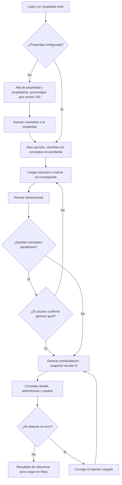

# Requerimientos: Sistema de asistencia para preliquidación de alquileres

Trabajo Final Integrador, Tecnicatura Universitaria en Programación a Distancia
Alumnos: Olima, Nicolás / Pannunzio, Nicolás. Tutor: Londero, Oscar. Entrega final: 21 de noviembre.

Este documento es el backlog de implementación y el borrador de las secciones "Objetivos y alcance" y "Análisis y modelo" del Informe Final. No repite el modelo: la arquitectura está en [`arquitectura.md`](arquitectura.md), los módulos en [`listado_modulos.md`](listado_modulos.md), el DER en [`diagrama_ER.md`](diagrama_ER.md) y el DDL en [`../database/esquema_completo.sql`](../database/esquema_completo.sql). Las referencias "R1" y "R2" remiten a la primera y segunda devolución de Londero ([`wiki/01_devoluciones_feedback.md`](../../wiki/01_devoluciones_feedback.md)); "Decisión n" remite a la tabla de decisiones de [`CAMBIOS.md`](../CAMBIOS.md).

## 1. Propósito

En la inmobiliaria, los conceptos variables de cada propiedad (TGI, agua, gas, EPE, expensas, seguros) se cargan a mano, sin validación de duplicados ni control de faltantes, y el reparto entre copropietarios se calcula por fuera. La aplicación asiste esa tarea: arma el checklist de conceptos esperados por período, valida los importes, advierte variaciones inusuales y genera una **preliquidación**, un resumen validado y versionado de conceptos variables con su reparto entre propietarios. La liquidación oficial, el cobro y la facturación siguen en Maru. La aplicación no reemplaza a Maru ni se integra técnicamente con él.

## 2. Alcance

Incluido en la entrega del 21/11 (los 11 módulos de [`listado_modulos.md`](listado_modulos.md)):

- Login con Supabase Auth y autorización por rol en el backend.
- Gestión de usuarios desde una pantalla propia (alta, edición, baja lógica, rol).
- ABM de propiedades, propietarios y porcentajes de reparto.
- Catálogo global de conceptos, con umbral de variación opcional por concepto.
- Plantilla de conceptos por propiedad.
- Apertura de período con checklist persistido.
- Carga de importes con control de duplicados; admite importes negativos y $0.
- Advertencias de variación inusual, sin referencia, total negativo y pendiente confirmado.
- Generación de la preliquidación como snapshot inmutable y versionado, con detalle, reparto y advertencias.
- Consulta de la versión vigente y de las versiones anteriores.
- Registro de auditoría de las operaciones de escritura relevantes.
- Despliegue de los tres componentes online: Supabase, Render y Vercel.

Fuera de alcance (detalle y motivos en [`arquitectura.md`](arquitectura.md), sección 10):

- Gestión de contratos e inquilinos.
- Alertas de vencimiento de contratos.
- Envío de emails y elección de un proveedor de email.
- Integración con WhatsApp.
- Vigencia temporal de los porcentajes de reparto.
- Integración técnica con Maru.
- Carga del alquiler base o reconstrucción de la liquidación que ya calcula Maru (R1, ítem 1).

## 3. Actores y roles

El script SQL siembra dos roles en la tabla `rol`: `admin` y `operador`. Ambos corresponden al personal administrativo de la inmobiliaria.

| Rol | Definido en las fuentes | A definir |
|---|---|---|
| `admin` | Existe como rol. El primer administrador se crea a mano en Supabase Auth y se inserta su fila en `usuario` con rol `admin` ([`arquitectura.md`](arquitectura.md) 4.3). | Permisos exactos sobre cada operación. |
| `operador` | Existe como rol asignable desde la gestión de usuarios. | Permisos exactos sobre cada operación. |

Las fuentes no definen una matriz de permisos por rol. Solo establecen que el backend resuelve el rol y autoriza cada operación (RN-04). Ver la sección 9.

## 4. Flujo de trabajo

1. El usuario inicia sesión (HU-01).
2. Configuración, una vez por propiedad: alta de la propiedad y sus propietarios, porcentajes de reparto y conceptos que le corresponden (HU-03 a HU-06).
3. Abre el período de una propiedad. El sistema genera el checklist con un concepto `pendiente` por cada concepto activo (HU-07).
4. Carga los importes o marca los conceptos que no corresponden (HU-08, HU-09).
5. Revisa las advertencias de variación y sin referencia (HU-10).
6. Genera la preliquidación. Si quedan pendientes, debe confirmarlo de forma explícita. El sistema guarda la versión 1 (HU-11).
7. Consulta el detalle, las advertencias y el reparto de cualquier versión (HU-12).
8. Caso de corrección: detecta un error, corrige el importe y genera la versión 2. La versión 1 queda intacta y la vigente pasa a ser la 2 (HU-13, HU-14).

## 5. Módulos

Descripción completa en [`listado_modulos.md`](listado_modulos.md).

| # | Módulo | Propósito | HU |
|---|---|---|---|
| 1 | Autenticación de usuarios | Login con Supabase Auth y validación del token en el backend | HU-01 |
| 2 | ABM de Propiedades y Propietarios | Datos maestros y porcentajes de reparto | HU-03, HU-04 |
| 3 | Gestión de conceptos variables | Catálogo global con umbral opcional | HU-05 |
| 4 | Plantilla de conceptos por propiedad | Conceptos que corresponden a cada propiedad | HU-06 |
| 5 | Apertura de período y checklist | Conceptos esperados por período y su estado | HU-07, HU-09 |
| 6 | Carga y validación de importes | Importes por concepto y período, sin duplicados | HU-08, HU-13 |
| 7 | Cálculo de reparto | Importe por propietario con redondeo | HU-04, HU-11 |
| 8 | Preliquidación mensual | Snapshot versionado y consulta | HU-11, HU-12, HU-14 |
| 9 | Registro de auditoría | Quién hizo qué y cuándo | HU-02, HU-08, HU-09, HU-11, HU-13 |
| 10 | Gestión de usuarios y roles | Alta, edición y baja lógica con la Admin API | HU-02 |
| 11 | Advertencias | Variación inusual, sin referencia, total negativo | HU-10, HU-11 |

## 6. Reglas de negocio

| ID | Regla | Implementación | Fuente |
|---|---|---|---|
| RN-01 | El período se guarda siempre como el primer día del mes (ej. `2026-09-01`). | `ck_checklist_periodo_primer_dia`, `ck_importe_periodo_primer_dia`, `ck_preliquidacion_periodo_primer_dia`; el backend también lo valida antes de escribir. | R2, ítem 8 |
| RN-02 | `usuario.id` es el mismo UUID que `auth.users.id`. El alta crea primero la cuenta en Supabase Auth (Admin API) y luego la fila en `usuario`; si el insert falla, el backend elimina la cuenta de Auth recién creada. | `REFERENCES auth.users(id)` en `usuario.id`, sin `DEFAULT`; backend, router `/usuarios`. | R2, ítem 7a |
| RN-03 | La baja de un usuario es lógica (`usuario.activo = false`). | Backend. | Decisión 3 ([`arquitectura.md`](arquitectura.md) 4.3) |
| RN-04 | Solo el backend accede a los datos de negocio. Valida el JWT en cada request, resuelve el rol y autoriza la operación. `DATABASE_URL` y la clave `service_role` existen solo como variables de entorno en Render; el frontend usa la clave `anon` solo para el login. | `ENABLE ROW LEVEL SECURITY` en las 14 tablas, sin policies; vista `preliquidacion_vigente` con `security_invoker = true`; backend (`core`). | R2, ítem 7b |
| RN-05 | Un propietario no se repite en la misma propiedad, y cada porcentaje es mayor que 0 y hasta 100. | `UNIQUE (propiedad_id, propietario_id)` y `CHECK (porcentaje > 0 AND porcentaje <= 100)` en `propiedad_propietario`. | Decisión 6 |
| RN-06 | Los porcentajes de una propiedad suman 100. Un cambio reemplaza todas las filas de la propiedad en una sola transacción y valida la suma antes del `COMMIT`; si no suma 100, se revierte. Cambiar porcentajes no altera las preliquidaciones ya generadas. | Backend (capa de servicios), transacción única. | R2, ítem 4 |
| RN-07 | El nombre de un concepto es único en el catálogo sin distinguir mayúsculas de minúsculas (`TGI` y `tgi` son el mismo). Su umbral propio es `NULL` o mayor que 0. | Índice único `uq_concepto_nombre_ci` sobre `lower(nombre)`; `CHECK (umbral_variacion_pct > 0)`. | R2, ítem 5 |
| RN-08 | Un concepto se asocia una sola vez a cada propiedad y puede estar activo o inactivo. | `UNIQUE (propiedad_id, concepto_id)` en `concepto_propiedad`. | R1, ítem 6 |
| RN-09 | Abrir un período inserta una fila de `checklist_periodo` en estado `pendiente` por cada `concepto_propiedad` activo de la propiedad. No se repite un concepto en el checklist de un período, y la fila solo puede referir a conceptos de la misma propiedad. | Backend; `UNIQUE (propiedad_id, periodo, concepto_propiedad_id)` y `fk_checklist_concepto_propiedad`. | R2, ítem 3 |
| RN-10 | Estados del checklist: cargar un importe pasa la fila a `cargado`; el usuario puede marcar `no_corresponde` en cualquier momento, también sobre una fila ya `cargado` (RN-25). Un importe $0 es `cargado`; `pendiente` y `no_corresponde` no son importes. | `CHECK (estado IN ('pendiente', 'cargado', 'no_corresponde'))`; backend. | R1, ítem 6; R2, ítem 3 |
| RN-11 | Solo se cargan importes para conceptos que tienen fila en el checklist del período. | Backend. | Decisión 9 ([`arquitectura.md`](arquitectura.md) 4.5) |
| RN-12 | Hay un único importe por concepto de la propiedad y período. Un segundo importe para el mismo par se rechaza. | `uq_importe_concepto_periodo`; el backend devuelve un error explícito. | R1, ítem 3; R2, ítem 9 |
| RN-13 | Los importes admiten valores negativos (notas de crédito, bonificaciones) y $0, igual que `importe_total` y el importe de cada propietario en el reparto. | Sin `CHECK` de signo en `importe_mensual.importe`, `preliquidacion.importe_total` ni `reparto.importe_correspondiente`. | R2, ítem 8 |
| RN-14 | Corregir un importe cargado lo modifica en `importe_mensual` y registra el valor anterior en la auditoría. Las preliquidaciones ya generadas no cambian. | Backend; `auditoria.detalle`. | R1, ítem 5; observación de [`wiki/01`](../../wiki/01_devoluciones_feedback.md) |
| RN-15 | Variación = `\|actual − anterior\| / \|anterior\| × 100`, contra el importe del período inmediato anterior del mismo `concepto_propiedad`. Si supera el umbral efectivo (`COALESCE(concepto.umbral_variacion_pct, umbral global)`), se registra una advertencia `variacion_inusual`. Umbral global inicial: 30 % (a confirmar con la inmobiliaria). | Backend; variable `UMBRAL_VARIACION_DEFAULT_PCT` en Render. | R2, ítem 5 |
| RN-16 | Si no hay importe del período anterior, el concepto es nuevo o el valor anterior es 0, no se calcula variación: se registra solo una nota `sin_referencia`. | Backend. | R2, ítem 5 |
| RN-17 | Las advertencias nunca bloquean. Sus tipos son `variacion_inusual`, `sin_referencia`, `total_negativo` y `pendiente_confirmado`. | `CHECK (tipo IN (...))` en `preliquidacion_advertencia`. | R1, ítem 3; R2, ítem 5 |
| RN-18 | Generar una preliquidación se bloquea mientras haya filas `pendiente` en el checklist del período. El usuario puede continuar con una confirmación explícita, que se registra como una advertencia `pendiente_confirmado` por cada concepto pendiente (a confirmar con la inmobiliaria). | Backend. | R2, ítem 3; Decisión 9 |
| RN-19 | El detalle de la preliquidación guarda cada concepto en estado `cargado` (incluido $0) con su importe; `importe_total` es la suma del detalle. | Backend; `UNIQUE (preliquidacion_id, concepto_id)` en `preliquidacion_detalle`. | R2, ítem 2 |
| RN-20 | Si `importe_total` es negativo, se registra una advertencia `total_negativo`. | Backend. | Decisión 7 |
| RN-21 | Cada preliquidación tiene su propio reparto: copia el porcentaje vigente de cada propietario (`porcentaje_aplicado`) y calcula su importe redondeado a 2 decimales. El último propietario, en orden ascendente de id, absorbe la diferencia de centavos para que el reparto sume exactamente `importe_total`. Un propietario no se repite en una preliquidación. | Backend; `UNIQUE (preliquidacion_id, propietario_id)` en `reparto`. | R2, ítems 4 y 8 |
| RN-22 | La primera preliquidación de una propiedad y período es la versión 1; cada nueva generación crea la versión siguiente. La vigente es la de mayor versión. | `UNIQUE (propiedad_id, periodo, version)`, `CHECK (version >= 1)`; vista `preliquidacion_vigente`; backend calcula `MAX(version) + 1`. | R2, ítem 2 |
| RN-23 | Una preliquidación generada no se modifica ni se borra: corregir significa generar una versión nueva. | `bloquear_modificacion_snapshot` con `tg_preliquidacion_inmutable`, `tg_preliquidacion_detalle_inmutable`, `tg_preliquidacion_advertencia_inmutable`, `tg_reparto_inmutable` y sus pares `*_sin_truncate`; FK sin `ON DELETE CASCADE`. | R2, ítems 2 y 9 |
| RN-24 | La carga y corrección de importes, la generación de preliquidaciones y el alta, la edición y la baja de usuarios se registran en `auditoria` con usuario, acción, entidad y fecha. Marcar un concepto como `no_corresponde` también se audita (RN-25). | Backend (módulo `audit`); tabla `auditoria`. | R1, ítem 5 |
| RN-25 | El usuario puede marcar una fila del checklist como `no_corresponde` en cualquier momento, también cuando ya está `cargado` y aunque exista una preliquidación del período. En una sola transacción el backend (a) borra la fila de `importe_mensual` de ese concepto y período, (b) registra en `auditoria.detalle` el valor anterior (importe, `cargado_por`, `fecha_carga`) junto con quién hizo el cambio y cuándo, y (c) pasa la fila del checklist a `no_corresponde`. Una fila `pendiente` solo cambia de estado, y la acción también se audita. Si la fila ya está `no_corresponde`, no cambia nada. Las preliquidaciones generadas no se alteran: `preliquidacion_detalle` guarda `concepto_id` e `importe` y no referencia `importe_mensual`, así que la versión 1 queda intacta y la versión siguiente se genera sin ese concepto. No es una nota de crédito: la nota de crédito es un importe negativo cargado como valor; `no_corresponde` es un estado sin importe. Tras el borrado, el período siguiente trata este período como `sin_referencia` (RN-16). | Backend: transacción única (borrado, auditoría y cambio de estado); `auditoria.detalle`. | Decisión del equipo |

## 7. Historias de usuario

Los criterios de aceptación son la base de los casos de prueba. En los ejemplos, "umbral global" es 30 %.

**HU-01. Iniciar sesión.** Como usuario de la inmobiliaria, quiero iniciar sesión con mi email y contraseña, para operar el sistema con mi rol. Prioridad: Alta. Reglas: RN-03, RN-04.

- Dado un usuario activo con cuenta en Supabase Auth, cuando inicia sesión con credenciales válidas, entonces accede a la aplicación y cada request al backend lleva su token.
- Dada una request al backend sin token o con un token inválido, cuando llega a cualquier endpoint de datos, entonces el backend responde 401 y no devuelve datos.
- Dado un usuario con `activo = false`, cuando llama a la API con un token válido, entonces el backend responde 403 con el código de error `usuario_inactivo` y no devuelve datos.
- Dado el token de un usuario, cuando se consulta una tabla de negocio a través de la Data API de Supabase con la clave `anon`, entonces no se devuelve ninguna fila.

**HU-02. Gestionar usuarios.** Como usuario con rol `admin`, quiero dar de alta, editar y dar de baja usuarios desde la aplicación, para no usar el dashboard de Supabase. Prioridad: Alta. Reglas: RN-02, RN-03, RN-24.

- Dado un email nuevo, un rol y una contraseña inicial que define el admin, cuando doy de alta el usuario, entonces existe la cuenta en Supabase Auth y una fila en `usuario` con el mismo id y el rol elegido.
- Dado que el insert en `usuario` falla (por ejemplo, email repetido), cuando termina el alta, entonces no queda la cuenta en Supabase Auth.
- Dado un usuario activo, cuando lo doy de baja, entonces queda con `activo = false`, la fila no se borra y la baja figura en `auditoria`.
- Dado un `admin`, cuando intenta darse de baja o cambiarse el rol a sí mismo, entonces el sistema responde 409 con el código `autoedicion_no_permitida` y no cambia nada; sí puede editar su propio nombre, y puede dar de baja o cambiar el rol de otro administrador.

**HU-03. Registrar propiedades y propietarios.** Como usuario, quiero dar de alta y editar propiedades y propietarios, para tener los datos maestros del reparto. Prioridad: Alta. Reglas: RN-05.

- Dada una propiedad nueva con dirección, cuando la guardo, entonces queda en estado `activa`.
- Dado un propietario ya asociado a una propiedad, cuando intento asociarlo otra vez a la misma propiedad, entonces el sistema lo rechaza.

**HU-04. Definir porcentajes de reparto.** Como usuario, quiero definir el porcentaje de cada propietario de una propiedad, para que el reparto se calcule solo. Prioridad: Alta. Reglas: RN-05, RN-06.

- Dada una propiedad con dos propietarios al 50/50, cuando guardo 60/40, entonces quedan 60/40 y nunca se observa un estado intermedio (60/50 o 50/40).
- Dados porcentajes que suman 90 o 110, cuando los guardo, entonces el sistema rechaza el cambio y se conservan los porcentajes anteriores.
- Dado un porcentaje 0 o mayor que 100, cuando lo guardo, entonces el sistema lo rechaza.
- Dada una preliquidación ya generada con 50/50, cuando cambio a 60/40, entonces su reparto sigue mostrando 50/50.

**HU-05. Mantener el catálogo de conceptos.** Como usuario, quiero dar de alta conceptos (TGI, EPE, expensas, etc.) con un umbral de variación opcional, para reutilizarlos en todas las propiedades. Prioridad: Alta. Reglas: RN-07.

- Dado un concepto con un nombre existente, cuando lo guardo, entonces el sistema lo rechaza.
- Dado un concepto sin umbral, cuando lo guardo, entonces queda con umbral `NULL` y usa el umbral global.
- Dado un umbral 0 o negativo, cuando lo guardo, entonces el sistema lo rechaza.

**HU-06. Asociar conceptos a una propiedad.** Como usuario, quiero indicar qué conceptos corresponden a cada propiedad, para que el checklist de cada período salga de esa plantilla. Prioridad: Alta. Reglas: RN-08.

- Dado un concepto ya asociado a la propiedad, cuando lo asocio otra vez, entonces el sistema lo rechaza.
- Dado un concepto asociado, cuando lo desactivo, entonces no aparece en el checklist de los períodos que se abran después.

**HU-07. Abrir un período.** Como usuario, quiero abrir un período para una propiedad, para ver qué conceptos faltan cargar. Prioridad: Alta. Reglas: RN-01, RN-09, RN-10.

- Dada una propiedad con 4 conceptos activos y 1 inactivo, cuando abro septiembre de 2026, entonces se crean 4 filas en estado `pendiente` con período `2026-09-01`.
- Dado un período que no es el primer día del mes (ej. `2026-09-15`), cuando intento abrirlo, entonces el sistema lo rechaza con 422 y no crea filas; nunca normaliza ni guarda otro día.
- Dado un período ya abierto, cuando lo abro otra vez, entonces no se crean filas duplicadas.

**HU-08. Cargar importes.** Como usuario, quiero cargar el importe de cada concepto del período, para tener los datos validados. Prioridad: Alta. Reglas: RN-10, RN-11, RN-12, RN-13, RN-24.

- Dado un concepto `pendiente`, cuando cargo $15.000, entonces la fila pasa a `cargado` y la carga queda en `auditoria` con mi usuario.
- Dado un concepto con importe ya cargado en el período, cuando cargo otro importe para el mismo concepto y período, entonces el sistema lo rechaza con un mensaje de duplicado y conserva el primero.
- Dado un importe de −$2.000 (nota de crédito) o de $0, cuando lo cargo, entonces se acepta y la fila pasa a `cargado`.
- Dado un concepto sin fila en el checklist del período, cuando intento cargarle un importe, entonces el sistema lo rechaza.

**HU-09. Marcar un concepto como no corresponde.** Como usuario, quiero marcar un concepto que este mes no aplica, para distinguirlo de uno que falta cargar. Prioridad: Alta. Reglas: RN-10, RN-25.

- Dado un concepto `pendiente`, cuando lo marco, entonces pasa a `no_corresponde` y no tiene importe.
- Dado un checklist con un concepto en $0 y otro en `no_corresponde`, cuando lo consulto, entonces se muestran como estados distintos.
- Dado un concepto `cargado` con importe X, cuando lo marco como no corresponde, entonces se borra su fila de `importe_mensual`, la fila del checklist queda en `no_corresponde` y `auditoria` guarda el importe anterior X, el usuario que hizo el cambio y la fecha.
- Dada una versión 1 ya generada que incluye ese concepto, cuando lo marco como no corresponde y genero la versión 2, entonces el detalle de la versión 2 no tiene fila para ese concepto y el detalle de la versión 1 no cambia.
- Dado un concepto `pendiente` o `cargado`, cuando intento marcarlo como no corresponde, entonces la pantalla pide confirmación (si estaba `cargado`, indica que se eliminará el importe) y no cambia nada hasta que confirmo; si cancelo, la fila y su importe quedan como estaban.

**HU-10. Revisar advertencias de variación.** Como usuario, quiero ver qué importes varían mucho respecto del mes anterior, para revisarlos antes de generar. Prioridad: Media. Reglas: RN-15, RN-16, RN-17.

- Dado un concepto sin umbral propio con $1.000 en agosto, cuando cargo $1.350 en septiembre (35 %), entonces se muestra una advertencia `variacion_inusual`; con $1.200 (20 %), no.
- Dado el mismo caso con un concepto de umbral propio 50 %, cuando cargo $1.350, entonces no se muestra advertencia de variación.
- Dado $1.000 en agosto, cuando cargo −$200 en septiembre (120 %), entonces se muestra `variacion_inusual`.
- Dado un concepto sin importe en agosto, o con $0 en agosto, cuando cargo septiembre, entonces no hay advertencia de variación y se muestra solo `sin_referencia`.
- Dada cualquier advertencia, cuando intento generar la preliquidación, entonces la advertencia no impide generarla.

**HU-11. Generar la preliquidación.** Como usuario, quiero generar la preliquidación de una propiedad y un período, para obtener el resumen validado con su reparto. Prioridad: Alta. Reglas: RN-17, RN-18, RN-19, RN-20, RN-21, RN-22, RN-24.

- Dado un checklist con un concepto `pendiente`, cuando intento generar sin confirmar, entonces el sistema no genera nada e informa el concepto pendiente.
- Dado el mismo checklist, cuando confirmo explícitamente, entonces se genera la versión 1 con una advertencia `pendiente_confirmado` por cada concepto pendiente.
- Dados conceptos cargados de $8.000, $0 y $2.000 y uno `no_corresponde`, cuando genero, entonces el detalle tiene 3 filas, sin el `no_corresponde`, y `importe_total` es $10.000.
- Dado un total de $10,00 con porcentajes 33,33 / 33,33 / 33,34, cuando genero, entonces el reparto es 3,33 / 3,33 / 3,34 en orden ascendente de id y suma exactamente $10,00; el propietario de mayor id absorbe el centavo de diferencia.
- Dado un total de −$500, cuando genero, entonces se registra una advertencia `total_negativo` y los importes del reparto son negativos.

**HU-12. Consultar preliquidaciones.** Como usuario, quiero consultar la preliquidación vigente y las versiones anteriores, para saber qué conceptos, importes y reparto se usaron. Prioridad: Alta. Reglas: RN-21, RN-22.

- Dada una propiedad y un período con versiones 1 y 2, cuando consulto la vigente, entonces se muestra la versión 2.
- Dada la versión 1, cuando la consulto, entonces veo su detalle, sus advertencias y su reparto tal como se generaron, sin depender de `auditoria`.

**HU-13. Corregir un importe ya preliquidado.** Como usuario, quiero corregir un importe mal cargado después de generar la preliquidación, para que la siguiente versión use el valor correcto. Prioridad: Alta. Reglas: RN-14, RN-24.

- Dado un importe de $86.200 incluido en la versión 1, cuando lo corrijo a $68.200, entonces `importe_mensual` queda en $68.200 y `auditoria` registra el valor anterior, el usuario y la fecha.
- Dado el mismo caso, cuando consulto la versión 1, entonces su detalle sigue mostrando $86.200.

**HU-14. Generar una nueva versión.** Como usuario, quiero regenerar la preliquidación de un período ya preliquidado, para reemplazar la versión con error sin perder la anterior. Prioridad: Alta. Reglas: RN-22, RN-23.

- Dada una versión 1 existente, cuando genero otra vez para la misma propiedad y período, entonces se crea la versión 2 con el importe corregido y la vigente pasa a ser la 2.
- Dada la versión 2 generada, cuando consulto la versión 1, entonces su cabecera, detalle, advertencias y reparto son idénticos a los que tenía antes de generar la versión 2.
- Dada cualquier preliquidación, cuando se ejecuta `UPDATE`, `DELETE` o `TRUNCATE` sobre `preliquidacion`, `preliquidacion_detalle`, `preliquidacion_advertencia` o `reparto`, entonces la base de datos lo rechaza.

## 8. Trazabilidad

| HU | RN | Módulo | Corrección de Londero |
|---|---|---|---|
| HU-01 | RN-03, RN-04 | 1 | R2, ítem 7b |
| HU-02 | RN-02, RN-03, RN-24 | 10, 9 | R2, ítem 7a |
| HU-03 | RN-05 | 2 | — |
| HU-04 | RN-05, RN-06 | 2, 7 | R2, ítem 4 |
| HU-05 | RN-07 | 3 | R2, ítem 5 |
| HU-06 | RN-08 | 4 | R1, ítem 6 |
| HU-07 | RN-01, RN-09, RN-10 | 5 | R2, ítems 3 y 8 |
| HU-08 | RN-10, RN-11, RN-12, RN-13, RN-24 | 6, 5, 9 | R2, ítems 8 y 9 (impedir duplicado) |
| HU-09 | RN-10, RN-25 | 5, 9 | R2, ítem 3 |
| HU-10 | RN-15, RN-16, RN-17 | 11 | R2, ítem 5 |
| HU-11 | RN-17, RN-18, RN-19, RN-20, RN-21, RN-22, RN-24 | 8, 7, 11, 9 | R2, ítems 2, 3, 4 y 8 |
| HU-12 | RN-21, RN-22 | 8 | R2, ítem 2 |
| HU-13 | RN-14, RN-24 | 6, 9 | R1, ítem 5; R2, ítem 9 (caso de corrección) |
| HU-14 | RN-22, RN-23 | 8 | R2, ítems 2 y 9 |

## 9. Decisiones confirmadas y pendientes

Confirmadas por el equipo:

- Solo `admin` gestiona usuarios (HU-02). Las fuentes no definen los permisos de cada rol; no se amplían.
- Un usuario inactivo (`activo = false`) es rechazado por la API con 403 y el código de error `usuario_inactivo` (HU-01).
- El alta de un usuario incluye una contraseña inicial que define el admin (HU-02). La contraseña no se guarda en `usuario`, ni en `auditoria`, ni en los logs. No hay cambio forzado de contraseña en el primer ingreso: es una limitación conocida que se documenta en el informe.
- La carga de importes guarda por fila: cada importe se persiste al guardarlo (HU-08). La confirmación del período es generar la preliquidación, no un paso de cierre aparte.
- El usuario puede marcar `no_corresponde` sobre una fila ya `cargado`, sin importar si existe una preliquidación del período. El backend borra el importe, guarda el valor anterior en `auditoria.detalle` y cambia el estado en una transacción; las versiones ya generadas no cambian y la siguiente se genera sin ese concepto (RN-25, HU-09).
- Marcar `no_corresponde` pide confirmación en la pantalla antes de ejecutarse; si la fila está `cargado`, el aviso indica que se elimina el importe (HU-09).
- Un período que no es el primer día del mes se rechaza con 422; no se normaliza (RN-01, HU-07).
- Formato único de error: `{"codigo", "mensaje", "detalle"}` en todas las respuestas de error, incluidos los 422 de validación.
- Falla del alta en Supabase Auth: 502 `auth_error` si falla la Admin API (no se crea nada); 500 `error_interno` si falla el insert en `usuario`, tras compensar borrando el usuario de Auth. Si la compensación falla, se loguea el id huérfano y se documenta como limitación (HU-02).
- Un email repetido en el alta responde 409 `email_duplicado`, ya sea que lo detecte Supabase Auth o la restricción `UNIQUE` de `usuario`; en el segundo caso se compensa borrando la cuenta de Auth recién creada. El email se guarda en minúsculas. Una contraseña que Supabase Auth rechaza por débil responde 422 `contrasena_invalida` (HU-02).
- Un `admin` no puede darse de baja ni cambiarse el rol a sí mismo: 409 `autoedicion_no_permitida`. Lo tiene que hacer otro administrador. Así el último administrador activo nunca se queda sin acceso a la gestión de usuarios. Limitación conocida: si dos administradores se dan de baja entre sí exactamente al mismo tiempo, podrían quedar sin ningún administrador activo; se recupera a mano desde Supabase (HU-02).
- La edición de un usuario (nombre o rol) se audita con el valor anterior y el nuevo en `auditoria.detalle`; si no cambia nada, no se audita. Dar de baja a un usuario que ya está inactivo responde 200 sin cambios ni auditoría (RN-24, HU-02).
- Generar una preliquidación sin checklist, sin reparto o con porcentajes que no suman 100 responde 409 (`periodo_sin_checklist`, `propiedad_sin_reparto`, `reparto_invalido`), igual que los pendientes sin confirmar (HU-11).
- Entorno de desarrollo: tests automáticos y CI contra PostgreSQL local descartable; un único proyecto Supabase para integración y demo.
- Un mes anterior sin importe (por ejemplo, marcado como no corresponde) cuenta como "sin referencia".
- Corregir un importe actualiza `importe_mensual` y guarda el valor anterior en `auditoria.detalle` (RN-14).
- Las advertencias se muestran antes de generar y se guardan al generar la preliquidación.
- Redondeo a 2 decimales: mitad hacia arriba (`ROUND_HALF_UP` con `Decimal`) (RN-21).
- Abrir un período ya abierto devuelve el checklist existente, sin error (HU-07).
- Un importe duplicado se rechaza, no solo se advierte.

Pendientes:

- Umbral global de variación de 30 % (RN-15): valor inicial, a confirmar con la inmobiliaria.
- Bloqueo de la generación con conceptos pendientes y su confirmación explícita (RN-18): a confirmar con la inmobiliaria.
- Resuelto: la versión de PostgreSQL de Supabase es 17.6, compatible con la vista `preliquidacion_vigente` (`security_invoker = true`, requiere PostgreSQL 15 o superior).
